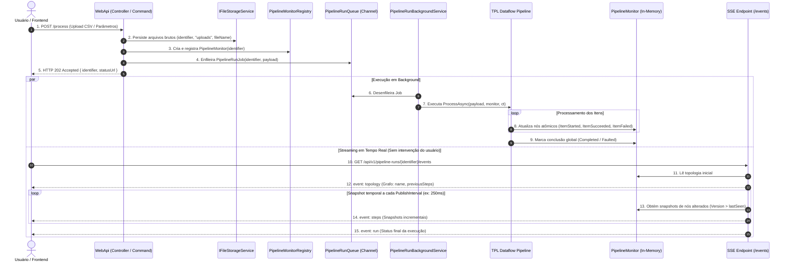
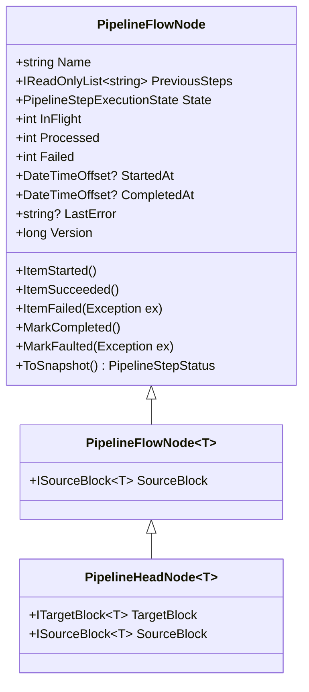
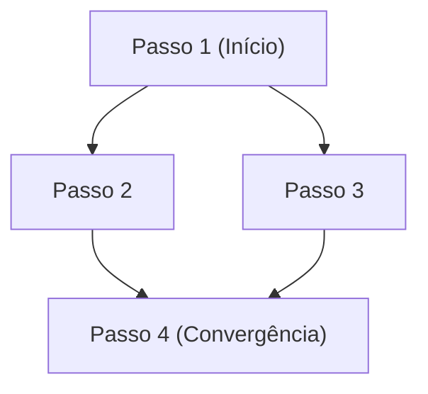

# Planejamento Técnico: Execução Assíncrona (HTTP 202 Accepted), Monitoramento SSE, Topologia Simplificada e Purga de Códigos Legados

> **Nota:** Este documento é uma cópia sincronizada do planejamento mestre localizado em [pipeline-monitoring-and-topology-plan.md](file:///d:/Mello%20Silveira%20Servi%C3%A7os%20LTDA/Projetos/Tools/.agents/prompts/pipeline-monitoring-and-topology-plan.md).

## 1. Visão de Negócio e Arquitetura de Execução

### 1.1 Fluxo Operacional
O fluxo de execução e monitoramento de pipelines de processamento numérico e análise de dados experimentais é estruturado da seguinte forma:



### 1.2 Regras de Ouro da Arquitetura
1. **Zero Retrocompatibilidade e Purga Radical de Código Morto:**
   - Não serão mantidas interfaces, parâmetros ou métodos obsoletos por compatibilidade.
   - Qualquer componente que não sirva à arquitetura simplificada será excluído imediatamente.
2. **Princípio de Responsabilidade Única (SRP):**
   - **`PipelineStepExecutor`**: Focado estritamente na execução do passo, gerenciamento do ciclo de vida de `Activity` (OpenTelemetry), log estruturado e política de retry. Não faz throttling, não conhece HTTP e não envia eventos pela rede.
   - **`PipelineFlowNode`**: Estrutura unificada que encapsula o bloco TPL Dataflow, as dependências topológicas imediatas (`PreviousSteps`) e os contadores atômicos em memória.
   - **`PipelineMonitor`**: Concentra o estado da execução e a coleção de `PipelineFlowNode` de um determinado `identifier`.
   - **`PipelineMonitorRegistry`**: Gerencia instâncias de `PipelineMonitor` em memória (`ConcurrentDictionary`) com expiração temporal (TTL) controlada por `TimeProvider`.
   - **`PipelineMonitoringSettings`**: Configuração centralizada para o host (Background Service, Registry, Endpoint SSE). **NUNCA** atravessada para construtores de builders ou steps da pipeline.
3. **Consumo por Pull Temporal no SSE em vez de Push por Item:**
   - O pipeline processa dados em velocidade nativa sem overhead de sincronização de rede ou lock em canais.
   - O endpoint SSE extrai snapshots em intervalos regulares (`PublishInterval`) usando `TypedResults.ServerSentEvents`, notificando apenas etapas cuja `Version` sofreu alteração.

---

## 2. Inventário Exaustivo de Remoção de Códigos Legados

### 2.1 Classes e Arquivos a Serem Excluídos Definitivamente

| Arquivo / Componente Legado | Motivo da Remoção |
|---|---|
| `src/MelloSilveiraTools.Core/Pipelines/Notifiers/IPipelineProgressNotifier.cs` | Conceito per-request (scoped) incompatível com desacoplamento assíncrono 202. Gerava duplicidade com o tracker. |
| `src/MelloSilveiraTools.Core/Pipelines/Notifiers/ChannelPipelineProgressNotifier.cs` | Canal per-request que gerava contenção de memória e sobrecarga no TPL Dataflow. |
| `src/MelloSilveiraTools.Core/Pipelines/Notifiers/NullPipelineProgressNotifier.cs` | Desnecessário após a eliminação da abstração de notifiers. |
| `src/MelloSilveiraTools.Core/Pipelines/Telemetry/PipelineFlowNode.cs` | Versão antiga pesada substituída pelo `PipelineFlowNode` unificado (bloco + topologia + contadores). |
| `src/MelloSilveiraTools.Core/Pipelines/Telemetry/PipelineStepTracker.cs` | Classe sobrecarregada que misturava contagem, envio de eventos e decisões de throttling. Totalmente absorvida pelo `PipelineFlowNode`. |
| `src/MelloSilveiraTools.Core/Pipelines/Telemetry/PipelineProgressNotificationSettings.cs` | Parâmetro atravessado em construtores para controlar números mágicos (50/500). Totalmente removido de builders e steps. |
| `src/MelloSilveiraTools.Core/Pipelines/Models/PipelineProgressEvent.cs` | DTO push legado com heurísticas desnecessárias e campos calculados imprecisos. |
| `src/MelloSilveiraTools.Core/Pipelines/Models/PipelineStepState.cs` | Substituído pelo novo enum simplificado `PipelineStepExecutionState`. |
| `src/MelloSilveiraTools.MechanicsOfMaterials.Optimizations/Controllers/PipelineProgressStreamWriter.cs` | Anti-pattern de executar a pipeline síncrona dentro da requisição HTTP de stream NDJSON. |
| `test/UnitTests/Core/Pipelines/Models/PipelineProgressEventTests.cs` | Testes do DTO legado excluído. |
| `test/UnitTests/Core/Pipelines/Notifiers/ChannelPipelineProgressNotifierTests.cs` | Testes da classe excluída. |
| `test/UnitTests/Core/Pipelines/Telemetry/PipelineProgressEmissionTests.cs` | Testes acoplados à lógica antiga de throttling e notifiers. |

### 2.2 Endpoints Legados a Serem Removidos
- `POST /api/v1/experimental-data/process/stream` em `ExperimentalDataController.cs`.
- `POST /api/v1/parametric-sweeps/stream` em `ParametricSweepController.cs`.

### 2.3 Parâmetros Atravessados a Serem Purgados
- **Dependency Injection:**
  - Remover `bool enablePipelineProgressNotifications` e `PipelineProgressNotificationSettings?` de `CoreDependencyInjection` e `DependencyInjection`.
  - Registrar exclusivamente `PipelineMonitoringSettings` no container de injeção de dependência com validação eager.
- **Builders e Factories:**
  - Remover `IPipelineProgressNotifier` e `PipelineProgressNotificationSettings` de `PipelineFactory.StartDataflow<T>` e `DataflowPipelineBuilder`.
- **Pipelines de Domínio (`ExperimentalDataProcessingPipeline`, `ParametricSweepPipeline`):**
  - Remover referências a notifiers ou configurações de notificação de seus construtores.
  - A execução recebe o monitor correspondente à análise: `ProcessAsync(payload, monitor, cancellationToken)`.
- **`PipelineStepExecutor`:**
  - Redução de ~800 linhas para ~120-150 linhas.
  - Eliminar verificações de throttling (`itemCount % 500 == 0`) e bifurcações condicionais (`stepTracker != null`).

---

## 3. Unificação de Bloco e Topologia em `PipelineFlowNode`

### 3.1 O Problema da Redundância no `DataflowPipelineBuilder`
No construtor atual de `DataflowPipelineBuilder<THead, TTail>`, existiam 4 variáveis separadas representando os extremos da pipeline, além de rastreadores externos:
- `ITargetBlock<THead> headBlock` (bloco de entrada inicial)
- `ISourceBlock<TTail> tailBlock` (bloco de saída da etapa anterior/atual)
- `PipelineFlowNode rootFlowNode` (raiz da telemetria)
- `PipelineFlowNode currentFlowNode` (nó de telemetria da etapa anterior/atual)
- `List<PipelineStepTracker> _stepTrackers` (rastreadores de métricas)

### 3.2 A Solução: Modelo Unificado
Unificamos os blocos TPL Dataflow, a topologia e as métricas de monitoramento em uma única estrutura coesa: **`PipelineFlowNode`**.



Cada método do `DataflowPipelineBuilder` cria o seu respectivo `PipelineFlowNode`, interligando o `SourceBlock` do passo anterior ao `TargetBlock` do passo atual, e repassando o nome do passo anterior para compor `PreviousSteps`.

### 3.3 Construtor do Builder Simplificado
```csharp
internal class DataflowPipelineBuilder<THead, TTail>(
    ILogger logger,
    PipelineHeadNode<THead> rootNode,
    PipelineFlowNode<TTail> currentNode,
    TimeProvider timeProvider,
    ITargetBlock<FailedPayload>? deadLetterQueueBlock = null,
    RetryOptions? retryOptions = null,
    List<PipelineFlowNode>? nodes = null,
    List<Task>? branchCompletionTasks = null,
    List<IPipelineStep>? steps = null,
    CancellationToken pipelineCancellationToken = default)
```

- **`rootNode`**: Fornece o `TargetBlock` inicial de entrada da pipeline onde `SendAsync` injeta os dados.
- **`currentNode`**: Fornece o `SourceBlock` de onde o próximo passo se conectará (`currentNode.SourceBlock.LinkTo(...)`) e indica quem é o predecessor (`currentNode.Name`).
- **`nodes`**: Coleção acumulada de todos os nós criados para composição do grafo.

---

## 4. Topologia Mínima: "Antes e Atual"

### 4.1 Estrutura do Grafo
Para que o frontend desenhe qualquer grafo (linear, bifurcado ou convergente), **é necessário apenas saber quem é o passo atual e quais foram os passos imediatamente anteriores**.

#### Exemplo (Bifurcação e Convergência):
- **Passo 1:** antes: `[]` (nada); atual: `"Passo1"`
- **Passo 2:** antes: `["Passo1"]`; atual: `"Passo2"`
- **Passo 3:** antes: `["Passo1"]`; atual: `"Passo3"`
- **Passo 4:** antes: `["Passo2", "Passo3"]`; atual: `"Passo4"`



A partir desta lista simples, o frontend constrói as arestas sem ambiguidades:
- `Passo1` $\rightarrow$ `Passo2`
- `Passo1` $\rightarrow$ `Passo3`
- `Passo2` $\rightarrow$ `Passo4`
- `Passo3` $\rightarrow$ `Passo4`

### 4.2 Dinâmica nos Métodos do Builder

1. **`PipelineFactory.StartDataflow<T>`:**
   - Cria o bloco de buffer inicial: `BufferBlock<T> buffer`.
   - Instancia: `PipelineHeadNode<T> root = new("Start", previousSteps: [], buffer, timeProvider);`
   - O builder inicial recebe `root` como `rootNode` e `currentNode`.

2. **`AddStep<TNextOut>(step)`:**
   - Predecessores: se `currentNode.Name == "Start"`, `previousSteps = []`; caso contrário, `previousSteps = [currentNode.Name]`.
   - Cria o bloco de execução TPL Dataflow (ex.: `TransformBlock<TTail, TNextOut>`).
   - Conecta: `currentNode.SourceBlock.LinkTo(nextBlock);`
   - Cria `PipelineFlowNode<TNextOut> nextNode = new(step.Name, previousSteps, nextBlock, timeProvider);`
   - Registra `nextNode` na lista `nodes`.
   - Retorna novo builder com `currentNode = nextNode`.

3. **`Fork(branch1, branch2)`:**
   - Conecta um `BroadcastBlock<TTail>` em `currentNode.SourceBlock`.
   - Executa as branches a partir de builders derivados com `currentNode`.
   - Ambas registram seus primeiros passos tendo `previousSteps = [currentNode.Name]`.
   - O `JoinBlock` une as saídas das duas branches (`resolvedBranch1.CurrentNode` e `resolvedBranch2.CurrentNode`).
   - O passo imediatamente seguinte que consome a tupla unificada recebe:
     `previousSteps = [resolvedBranch1.CurrentNode.Name, resolvedBranch2.CurrentNode.Name]`.

4. **`AddBroadcastStep(sideEffectStep)` (Observer):**
   - Cria um passo que roda em paralelo (ex.: gravação de dados intermediários em disco).
   - O nó observador é registrado com `Name = sideEffectStep.Name` e `previousSteps = [currentNode.Name]`.
   - O builder principal continua fluindo a partir do `currentNode` original, permitindo novas ramificações paralelas.

---

## 5. Informações Críticas de Cada Etapa e Contrato SSE

### 5.1 O que o Usuário Precisa Saber Durante a Execução
Como as etapas de uma pipeline orientada a fluxo (Dataflow) executam de forma assíncrona, não há uma ordem cronológica rígida entre passos (um step pode estar finalizando itens do lote anterior enquanto o próximo já começou a processar os primeiros itens). As informações essenciais para acompanhamento em tempo real são:

1. **Identificação e Topologia:** `name` e `previousSteps` (para situar a etapa no fluxograma visual).
2. **Estado de Execução:** `Pending`, `Started`, `Running`, `Completed` ou `Faulted`.
3. **Volume e Taxa de Processamento:**
   - `processed`: Quantidade de itens que concluíram a etapa com sucesso.
   - `inFlight`: Quantidade de itens sendo processados no momento exato (indica se o nó está ativo).
   - `failed`: Quantidade de falhas ou descartes ocorridos na etapa.
4. **Janela Temporal:**
   - `startedAt`: Momento do início do primeiro item.
   - `completedAt`: Momento em que o bloco encerrou o processamento de todos os itens.
5. **Diagnóstico de Falhas:**
   - `lastError`: Detalhe da mensagem de exceção caso o nó tenha falhado.

### 5.2 Contrato do Snapshot de Etapa
```csharp
public sealed record PipelineStepStatus(
    string Name,
    IReadOnlyList<string> PreviousSteps,
    PipelineStepExecutionState State,
    int Processed,
    int Failed,
    int InFlight,
    DateTimeOffset? StartedAt,
    DateTimeOffset? CompletedAt,
    string? LastError);
```

### 5.3 Contrato de Eventos Server-Sent Events (SSE)
**Rota:** `GET /api/v1/pipeline-runs/{identifier}/events`

#### Evento 1: `topology` (Emitido uma única vez logo após a abertura da conexão)
```sse
event: topology
data: [
  { "name": "ExperimentalDataSegmenter", "previousSteps": [] },
  { "name": "ExperimentalDataFileWriter", "previousSteps": ["ExperimentalDataSegmenter"] },
  { "name": "CurveSegmentAccumulator", "previousSteps": ["ExperimentalDataSegmenter"] },
  { "name": "MechanicalModelCurveFitter", "previousSteps": ["CurveSegmentAccumulator"] },
  { "name": "IdentifierBuilder", "previousSteps": ["MechanicalModelCurveFitter"] },
  { "name": "NumericalSimulation", "previousSteps": ["MechanicalModelCurveFitter"] },
  { "name": "DeltaCalculator", "previousSteps": ["NumericalSimulation"] },
  { "name": "AsymptoteMonitoring", "previousSteps": ["NumericalSimulation"] },
  { "name": "MechanicalModelOutputFileWriter", "previousSteps": ["NumericalSimulation"] },
  { "name": "MechanicalModelOutputPersistence", "previousSteps": ["NumericalSimulation"] }
]
```

#### Evento 2: `steps` (Emitido a cada `PublishInterval`, contendo apenas os nós alterados)
```sse
event: steps
data: [
  {
    "name": "ExperimentalDataSegmenter",
    "previousSteps": [],
    "state": "Completed",
    "processed": 15420,
    "failed": 0,
    "inFlight": 0,
    "startedAt": "2026-10-23T08:30:01.120Z",
    "completedAt": "2026-10-23T08:30:02.450Z",
    "lastError": null
  },
  {
    "name": "MechanicalModelCurveFitter",
    "previousSteps": ["CurveSegmentAccumulator"],
    "state": "Running",
    "processed": 3,
    "failed": 0,
    "inFlight": 2,
    "startedAt": "2026-10-23T08:30:02.500Z",
    "completedAt": null,
    "lastError": null
  }
]
```

#### Evento 3: `run` (Emitido no encerramento da execução global)
```sse
event: run
data: {
  "identifier": "exp-20261023-9c8e1a",
  "state": "Completed",
  "startedAt": "2026-10-23T08:30:01.120Z",
  "completedAt": "2026-10-23T08:30:07.890Z",
  "error": null
}
```

---

## 6. Governança de Storage: `(string identifier, string context)`

Em conformidade com a convenção estabelecida no sistema, toda e qualquer operação de arquivos organiza-se sob a premissa de que a **identidade da análise** precede o contexto funcional:
- **Ordem dos parâmetros:** `(string identifier, string context, string fileName)`
- **Layout de pastas em disco / S3 / Blob:** `{BaseDirectory}/{identifier}/{context}/{fileName}`

```
storage/
└── exp-20261023-9c8e1a/                <-- identifier da análise
    ├── uploads/                        <-- contexto de arquivos brutos enviados
    │   └── ensaio_tracao.csv
    ├── curves/                         <-- contexto de segmentos e ajustes
    │   └── relaxation_segment.csv
    └── simulations/                    <-- contexto de simulações numéricas
        └── viscoelastic_history.csv
```

Todos os métodos de `IFileStorageService` e implementações (`LocalFileStorageService`, `AwsS3FileStorageService`, `BlobStorageFileStorageService`, `DfsFileStorageService`) adotam estritamente essa assinatura, permitindo exclusão em lote de uma análise completa com base apenas no seu `identifier`.

---

## 7. Fases de Execução e Checklist de Implementação

### Fase 1: Núcleo Unificado de `PipelineFlowNode` e Enfileiramento
- [ ] Criar enum `PipelineStepExecutionState` (`Pending`, `Started`, `Running`, `Completed`, `Faulted`) e `PipelineRunState`.
- [ ] Criar os records DTO: `PipelineStepStatus`, `PipelineTopologyNode` e `PipelineRunSummary` sob `MelloSilveiraTools.Core.Pipelines.Monitoring.Models`.
- [ ] Implementar a hierarquia unificada de nós sob `MelloSilveiraTools.Core.Pipelines.Dataflow`:
  - `PipelineFlowNode`: Contadores atômicos (`Interlocked`), estado, `TimeProvider`, `Version` incremental e método `ToSnapshot()`.
  - `PipelineFlowNode<T>`: Herda de `PipelineFlowNode` e adiciona `ISourceBlock<T> SourceBlock`.
  - `PipelineHeadNode<T>`: Herda de `PipelineFlowNode<T>` e adiciona `ITargetBlock<T> TargetBlock`.
- [ ] Criar `PipelineMonitor` para gerenciar a coleção de nós de uma execução e seu estado global.
- [ ] Criar `PipelineMonitorRegistry` baseado em `ConcurrentDictionary<string, PipelineMonitor>` com descarte automático por TTL via `TimeProvider`.
- [ ] Criar a fila de execução em memória `PipelineRunQueue` baseada em `Channel<PipelineRunJob>` (bounded).
- [ ] Criar `PipelineRunBackgroundService` (`BackgroundService`) para consumir a fila em escopo de DI.
- [ ] Criar `PipelineMonitoringSettings` com validação eager (`PublishInterval > 0`, `RetentionAfterCompletion > 0`, `MaxConcurrentRuns > 0`).

### Fase 2: Purga de Legados e Refatoração de Builder e Executor
- [ ] **Excluir arquivos legados:**
  - `IPipelineProgressNotifier.cs`, `ChannelPipelineProgressNotifier.cs`, `NullPipelineProgressNotifier.cs`.
  - `PipelineStepTracker.cs`, `PipelineProgressNotificationSettings.cs`.
  - `PipelineProgressEvent.cs`, `PipelineStepState.cs`.
  - Arquivos de teste associados a notifiers e eventos legados.
- [ ] **Refatorar `PipelineStepExecutor`:**
  - Enxugar código para ~120-150 linhas focadas estritamente em telemetria OpenTelemetry, logs Serilog, retry com backoff e atualização atômica de `PipelineFlowNode` (`ItemStarted`, `ItemSucceeded`, `ItemFailed`).
- [ ] **Refatorar `DataflowPipelineBuilder`:**
  - Simplificar construtor para receber apenas `PipelineHeadNode<THead> rootNode` e `PipelineFlowNode<TTail> currentNode`.
  - Atualizar cada método (`AddStep`, `AddDataMapping`, `Fork`, `AddBroadcastStep`, etc.) para instanciar o respectivo `PipelineFlowNode`, amarrando `PreviousSteps = [currentNode.Name]`.
- [ ] **Atualizar DI:**
  - Purgar parâmetros antigos de `CoreDependencyInjection` e registrar serviços de monitoramento e background worker.

### Fase 3: Adaptação das Pipelines de Domínio (`Optimizations`)
- [ ] Refatorar `ExperimentalDataProcessingPipeline` e `ParametricSweepPipeline`:
  - Remover notifiers e trackers de seus construtores.
  - Ajustar o método `ProcessAsync` para aceitar `PipelineMonitor monitor`.
- [ ] Atualizar steps de persistência de arquivo (`ExperimentalDataFileWriterStep`, `MechanicalModelOutputFileWriterStep`, `ParametricSweepCsvWriterStep`) para utilizar a convenção de storage `(identifier, context, ...)`.

### Fase 4: WebApi (Command HTTP 202 Accepted + Endpoint SSE)
- [ ] Refatorar comandos (`ProcessExperimentalDataCommand`, `ExecuteParametricSweepCommand`):
  - Validar payload e persistir arquivos enviados no `IFileStorageService` sob `(identifier, "uploads", fileName)`.
  - Registrar novo `PipelineMonitor` no `PipelineMonitorRegistry`.
  - Enfileirar `PipelineRunJob` na `PipelineRunQueue`.
  - Retornar imediatamente `Result.CreateAccepted(...)` com HTTP 202 e cabeçalhos de status.
- [ ] Criar endpoint SSE (`PipelineRunsEndpoints` ou Controller):
  - Rota `GET /api/v1/pipeline-runs/{identifier}/events`.
  - Utilizar `TypedResults.ServerSentEvents(...)` para emitir `topology`, snapshots incrementais em `steps` e encerramento em `run`.
- [ ] Excluir `PipelineProgressStreamWriter.cs` e rotas legadas `/stream` e `/process/stream`.

### Fase 5: Validação, Testes e Documentação
- [ ] Implementar testes unitários para `PipelineFlowNode` (operações atômicas e snapshots).
- [ ] Implementar testes para o enfileiramento e execução via `PipelineRunBackgroundService`.
- [ ] Implementar testes de integração para o endpoint SSE e resposta HTTP 202.
- [ ] Executar suíte completa de testes: `dotnet test test/UnitTests/UnitTests.csproj`.
- [ ] Atualizar `AGENTS.md` e `CHANGELOG.md` documentando a nova arquitetura e a remoção dos termos legados.

---

## 8. Critérios de Aceite
1. **Compilação Limpa:** 0 erros e 0 warnings no build completo da solução (`dotnet build MelloSilveiraTools.sln`).
2. **Eliminação de Termos Obsoletos:** `git grep` para `IPipelineProgressNotifier`, `PipelineStepTracker` e `PipelineProgressNotificationSettings` deve retornar 0 ocorrências no código de produção.
3. **Simplicidade do Grafo:** A topologia retornada ao frontend é puramente declarativa com base em `{ name, previousSteps }`.
4. **Isolamento Completo (SRP):** Nenhuma classe de pipeline, builder ou step conhece `PipelineMonitoringSettings`.
5. **Eficiência de Rede:** O streaming SSE opera por amostragem temporal no servidor, garantindo que o processamento numérico de alta performance não sofra lentidão por I/O de rede.
