# Staff Technical Plan: Biomechanics Processing Pipelines, Topology Exposure, and Dynamic Notification

> **Document Type:** Master AI Planning and Architecture Specification  
> **Framework:** .NET 10 / C# 13  
> **Target Audience:** Autonomous AI Agents and Senior .NET Engineers  
> **Status:** Active Execution Ready  

---

## 1. Executive Summary and Architecture Overview

This document specifies the technical architecture and step-by-step implementation for extending the **MelloSilveiraTools** NuGet suite to fulfill the research requirements for soft-tissue biomechanics (viscoelastic modeling of knee ligaments at PPEMM/CEFET-RJ).

The design strictly separates **domain-agnostic infrastructure** (`MelloSilveiraTools.Core`) from **domain-specific biomechanical calculations** (`MelloSilveiraTools.MechanicsOfMaterials.Optimizations`), applying Domain-Driven Design (DDD), TPL Dataflow, and mathematical sensitivity formulations.

```mermaid
flowchart TD
    subgraph Core ["Agnostic Core (MelloSilveiraTools.Core)"]
        Builder["DataflowPipelineBuilder&lt;THead, TTail&gt;"] -->|Encapsulates blocks in| FlowNode["PipelineFlowNode&lt;TIn, TOut&gt;"]
        FlowNode -->|Exposes simple string collection| Upstream["UpstreamSteps: IReadOnlyList&lt;string&gt;"]
        FlowNode -->|Dispatches execution events| NotifierFactory["IPipelineProgressNotifierFactory"]
        NotifierFactory -->|User selects NDJSON| ChannelNotifier["ChannelPipelineProgressNotifier"]
        NotifierFactory -->|User selects Queue| QueueNotifier["MessageQueuePipelineProgressNotifier"]
        NotifierFactory -->|User selects None| NullNotifier["NullPipelineProgressNotifier"]
        Builder -->|Builds| Pipeline["DataflowPipeline&lt;TIn&gt;"]
        Pipeline -->|Exposes DAG to UI| Topology["Topology: IReadOnlyList&lt;PipelineTopologyNode&gt;"]
    end

    subgraph Optimizations ["Domain Mechanics (MechanicsOfMaterials.Optimizations)"]
        Command1["ExecuteParametricSweepCommand"] -->|Consumes canonical| Pipe1["IPipeline&lt;ParametricSweepInput, string&gt;"]
        Pipe1 -->|Generates 5 OAAT curves grouped by variable| CSV1["{VariableName}_SensitivityAnalysis.csv"]
        
        Command2["ExecuteVariableRelationshipCommand"] -->|Consumes canonical| Pipe2["IPipeline&lt;VariableRelationshipInput, VariableRelationshipOutput&gt;"]
        Pipe2 -->|Newton-Raphson 1D on Gradient ∂σ/∂p_k| Solver["Gradient Iso-Stress Solver"]
        Solver -->|Streams valid combinations for σ* at t*| CSV2["IsoStress_Combinations.csv"]
    end
```



---

## 2. Inviolable Coding and Architecture Rules

1. **Strictly NO `var`:** All variable declarations, loop variables, and object instantiations must state their explicit type (`int count = 0;`, `string name = string.Empty;`, `List<double> values = [];`).
2. **Collection Expressions `[...]`:** Collections, arrays, and lists must be instantiated using `[...]` syntax (e.g., `string[] names = ["a", "b"];`, `List<string> list = [];`, `IReadOnlyList<string> empty = [];`). Never use `new List<T>()` or `new T[] { ... }`.
3. **Simplicity Constraint for `UpstreamSteps` (KISS):**
   - The `UpstreamSteps` property on `PipelineFlowNode` and `PipelineTopologyNode` must be a simple, flat collection: `IReadOnlyList<string> UpstreamSteps { get; }`.
   - It contains only the immediate predecessor step names (e.g., `["PreviousStepName"]`, or `[]` for root steps, or `["Branch1Tail", "Branch2Tail"]` when joining forks).
   - Zero complex graph traversal, visitor objects, or recursive pointers.
4. **Primary Constructors:** Mandatory for dependency injection in classes and for data records.
5. **Mandatory `TimeProvider`:** Temporal operations and timestamps must inject and use `TimeProvider` (ambient `DateTime.UtcNow` is forbidden).
6. **Canonical Pipeline Contracts (No Sub-Interfaces):** Do NOT create `IParametricSweepPipeline` or `IExperimentalDataProcessingPipeline`. Consume `IPipeline<TInput, TOutput>` directly.
7. **Calculation Output Naming:** Calculation models must use the suffix `*Output` (never `*Result`).
8. **No Unit Tests, Validation, or Backward Compatibility Overhead:** Focus 100% on direct, functional feature delivery.

---

## 3. Mathematical Foundations: Iso-Stress and Sensitivity Analysis

### 3.1 Why `TargetTime` ($t^*$) and `TargetStress` ($\sigma^*$) Are Mandatory
In viscoelastic continuum mechanics, stress $\sigma(t)$ under a prescribed deformation history is time-dependent:
$$\sigma(t) = \mathcal{F}(\mathbf{p}, \varepsilon(t), t)$$
where $\mathbf{p} = [p_1, p_2, \dots, p_n]^T$ is the constitutive parameter vector.

A target stress $\sigma^*$ without a corresponding `TargetTime` ($t^*$) is physically and mathematically indeterminate:
* At the ramp peak ($t = t_{ramp}$), the stress reaches its instantaneous peak $\sigma_{peak}$.
* During the relaxation plateau ($t \to \infty$), stress relaxes toward an asymptote $\sigma_\infty$.
* Therefore, the condition $\sigma(t^*; \mathbf{p}) = \sigma^*$ is only well-posed when both $\sigma^*$ (`TargetStress`) and $t^*$ (`TargetTime`) are specified.

### 3.2 Gradient Artifice and Dimensionality Reduction for `VariableRelationshipPipeline`
A brute-force grid across $n$ parameters requires $O(k^n)$ simulations (for $n=5$ with 50 points per parameter, $50^5 = 3.125 \times 10^8$ simulations).

To eliminate this computational barrier:
1. **Implicit Function Theorem & 1D Root-Finding:**
   - Discretize $n-1$ parameters as free variables on an $(n-1)$-dimensional grid.
   - Designate one parameter $p_k$ with strong sensitivity ($\left|\frac{\partial \sigma}{\partial p_k}\right| > 0$) as the dependent variable.
   - For each combination of the free parameters, solve the 1D scalar root-finding equation:
     $$\Phi(p_k) = \sigma(t^*; p_1, \dots, p_k, \dots, p_n) - \sigma^* = 0$$
2. **Newton-Raphson Formulation using Stress Gradient:**
   - The partial derivative $\frac{\partial \sigma}{\partial p_k}$ is evaluated using `IDifferentiation` (central finite differences):
     $$\frac{\partial \sigma}{\partial p_k} \approx \frac{\sigma(p_k + h) - \sigma(p_k - h)}{2h}$$
   - Newton-Raphson iteration converges quadratically in 3 to 5 iterations:
     $$p_k^{(m+1)} = p_k^{(m)} - \frac{\sigma(t^*; \mathbf{p}^{(m)}) - \sigma^*}{\frac{\partial \sigma}{\partial p_k}(\mathbf{p}^{(m)})}$$
   - If $p_k \in [p_{k,min}, p_{k,max}]$, the combination is saved as an exact point on the iso-stress hypersurface.
3. **Continuation Method for 2-Parameter Contours:**
   Along an iso-stress contour in the plane $(p_1, p_2)$, $d\sigma = 0 \implies \frac{dp_2}{dp_1} = -\frac{\partial \sigma / \partial p_1}{\partial \sigma / \partial p_2}$, allowing direct numerical integration of the curve trajectory.

---

## 4. Phase-by-Phase Technical Specification

### Phase 1: Agnostic Dataflow Core Refactoring (`MelloSilveiraTools.Core`)

#### 1.1 Topology Contract and Exposure
* Create `PipelineTopologyNode.cs` in `MelloSilveiraTools.Core.Pipelines.Models`:
  ```csharp
  namespace MelloSilveiraTools.Core.Pipelines.Models;

  /// <summary>
  /// Represents a flat, lightweight description of a node in the pipeline DAG.
  /// </summary>
  /// <param name="StepName">The unique logical name of the step.</param>
  /// <param name="UpstreamSteps">Flat collection of direct immediate predecessor step names.</param>
  public sealed record PipelineTopologyNode(string StepName, IReadOnlyList<string> UpstreamSteps);
  ```
* Update `IDataflowPipeline<in TIn>` in `MelloSilveiraTools.Core.Pipelines.Dataflow`:
  ```csharp
  public interface IDataflowPipeline<in TIn> : IAsyncDisposable
  {
      IReadOnlyList<PipelineTopologyNode> Topology { get; }
      Task<bool> SendAsync(TIn item, CancellationToken cancellationToken = default);
      void Complete();
      Task Completion { get; }
  }
  ```
* In `DataflowPipeline<TIn>`, expose `Topology` computed from the registered step nodes.

#### 1.2 `PipelineFlowNode` Encapsulation
* Refactor `PipelineFlowNode` in `MelloSilveiraTools.Core.Pipelines.Telemetry`:
  - Encapsulate the underlying `IDataflowBlock` (e.g. `ITargetBlock`, `ISourceBlock`).
  - Store `StepName` (`string`).
  - Store `UpstreamSteps` as a simple, flat `IReadOnlyList<string>` (strictly direct predecessors).
  - Encapsulate the execution lifecycle reporting (`NotifyPendingAsync`, `NotifyItemEmittedAsync`, `NotifyCompletedAsync`) calling `IPipelineProgressNotifier`.
* In `DataflowPipelineBuilder.cs`:
  - Maintain all public fluent methods (`AddStep`, `AddDataMapping`, `AddForkingStep`, `AddBroadcastStep`, `BuildTerminal`).
  - Internally delegate block creation and DAG linking to `PipelineFlowNode`.

#### 1.3 Dynamic Progress Notification via User Parameters
* In `MelloSilveiraTools.Core.Pipelines.Notifiers`, define:
  ```csharp
  namespace MelloSilveiraTools.Core.Pipelines.Notifiers;

  /// <summary>
  /// Defines progress delivery modes supported by the pipeline execution.
  /// </summary>
  public enum ProgressNotificationMode
  {
      None = 0,
      StreamNdjson = 1,
      MessageQueue = 2
  }

  /// <summary>
  /// Agnostic publisher contract for dispatching events to external message brokers.
  /// </summary>
  public interface IMessageQueuePublisher
  {
      ValueTask PublishAsync<T>(string queueOrTopicName, T payload, CancellationToken cancellationToken = default);
  }
  ```
* Implement `MessageQueuePipelineProgressNotifier`:
  - Implements `IPipelineProgressNotifier`.
  - Injected with `IMessageQueuePublisher`, configured queue name, and `TimeProvider`.
  - Serializes and forwards `PipelineProgressEvent` to the publisher.
* Implement `IPipelineProgressNotifierFactory`:
  - Returns `ChannelPipelineProgressNotifier` when `mode == ProgressNotificationMode.StreamNdjson`.
  - Returns `MessageQueuePipelineProgressNotifier` when `mode == ProgressNotificationMode.MessageQueue`.
  - Returns `NullPipelineProgressNotifier.Instance` when `mode == ProgressNotificationMode.None`.

---

### Phase 2: OAAT Sensitivity Analysis Pipeline (`MelloSilveiraTools.MechanicsOfMaterials.Optimizations`)

#### 2.1 Canonical Pipeline Injection
* In `ProcessExperimentalDataCommand.cs`:
  - Change constructor parameter from `IExperimentalDataProcessingPipeline` to `IPipeline<ExperimentalDataProcessingInput, string> pipeline`.
* In `ExecuteParametricSweepCommand.cs`:
  - Change constructor parameter from `IParametricSweepPipeline` to `IPipeline<ParametricSweepInput, string> pipeline`.
* In `DependencyInjection.cs`:
  - Register `IPipeline<ExperimentalDataProcessingInput, string>` $\to$ `ExperimentalDataProcessingPipeline`.
  - Register `IPipeline<ParametricSweepInput, string>` $\to$ `ParametricSweepPipeline`.

#### 2.2 Variable-Grouped CSV Sensitivity Curves
* Update `ParametricSweepCsvWriterStep`:
  - Group payloads by `VariableName`.
  - For each variable, generate a dedicated partitioned CSV file:
    `{VariableName}_SensitivityAnalysis.csv`
  - Columns:
    ```csv
    VariableValue,InitialStress,FinalStress,AbsoluteDeltaStress,PercentageDeltaStress,AsymptoteTime
    ```
    - `InitialStress`: Stress at ramp end / relaxation start ($t = t_{ramp}$).
    - `FinalStress`: Stress at test completion ($t = t_{final}$).
    - `AbsoluteDeltaStress`: $|\sigma_{final} - \sigma_{initial}|$.
    - `PercentageDeltaStress`: $\frac{\sigma_{final} - \sigma_{initial}}{\sigma_{initial}} \times 100\%$.
    - `AsymptoteTime`: Time instant where $|d\sigma/dt| < \epsilon_{tol}$.
  - The frontend dynamically reads these CSV files to generate visual curves.

---

### Phase 3: Variable Relationship Pipeline (`MelloSilveiraTools.MechanicsOfMaterials.Optimizations`)

#### 3.1 Domain Models
Create in `MelloSilveiraTools.MechanicsOfMaterials.Optimizations.VariableRelationships.Models`:
* `ParameterBound(string ParameterName, double MinValue, double MaxValue, double Step)`
* `VariableRelationshipInput`:
  - `string MechanicalModelName`
  - `double TargetStress` ($\sigma^*$)
  - `double TargetTime` ($t^*$)
  - `double Tolerance` ($\epsilon$)
  - `IReadOnlyList<ParameterBound> ParameterBounds`
  - `ProgressNotificationMode NotificationMode`
* `VariableCombinationPoint(IReadOnlyDictionary<string, double> Parameters, double CalculatedStress, double Residual)`
* `VariableRelationshipOutput(string Identifier, IReadOnlyList<VariableCombinationPoint> Combinations, StorageEntryMetadata CsvMetadata)`

#### 3.2 Pipeline Topology
Create `VariableRelationshipPipeline.cs` implementing `IPipeline<VariableRelationshipInput, VariableRelationshipOutput>`:
1. `VariableGridGeneratorStep`: Discretizes $n-1$ parameters into a Cartesian stream.
2. `IsoStressNewtonRaphsonStep`: For each $(n-1)$ tuple, solves for $p_k$ satisfying $\sigma(t^*; \mathbf{p}) = \sigma^*$ using finite-difference gradient $\frac{\partial \sigma}{\partial p_k}$ and Newton-Raphson.
3. `IsoStressFilterStep`: Retains combinations where $p_k \in [p_{k,min}, p_{k,max}]$ and residual $\le \epsilon$.
4. `IsoStressCsvWriterStep`: Streams valid combinations to `{Identifier}_IsoStress_Combinations.csv`.
5. `VariableRelationshipPersistenceStep`: Persists execution metadata and returns `VariableRelationshipOutput`.

#### 3.3 Dependency Injection Registration
* Register `VariableRelationshipPipeline`, `VariableRelationshipCsvWriterStep`, and its command in `DependencyInjection.cs`.

---

## 5. Acceptance Criteria

1. **Compilation Cleanliness:**
   ```powershell
   dotnet build MelloSilveiraTools.sln
   ```
   Must exit with **0 errors**.
2. **Topology Verification:**
   `IDataflowPipeline<TIn>.Topology` returns the exact DAG node names with immediate `UpstreamSteps` for frontend consumption.
3. **No Redundant Interfaces:**
   `IParametricSweepPipeline` and `IExperimentalDataProcessingPipeline` are completely omitted in favor of `IPipeline<TIn, TOut>`.
4. **Partitioned CSV Outputs:**
   OAAT parametric sweeps produce clean, partitioned CSV files grouped by variable, ready for frontend chart plotting.
5. **Gradient Iso-Stress Convergence:**
   The variable relationship pipeline computes parameter combinations that accurately reproduce `TargetStress` at `TargetTime` within the requested tolerance.
