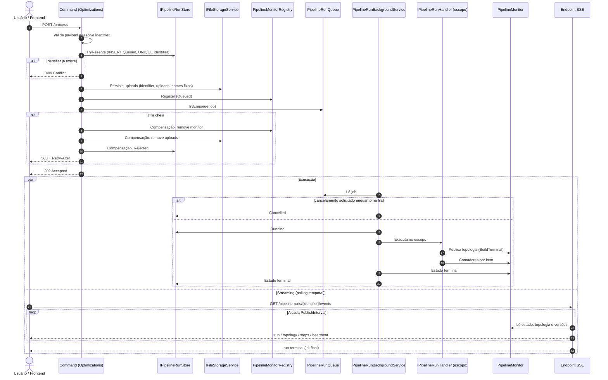
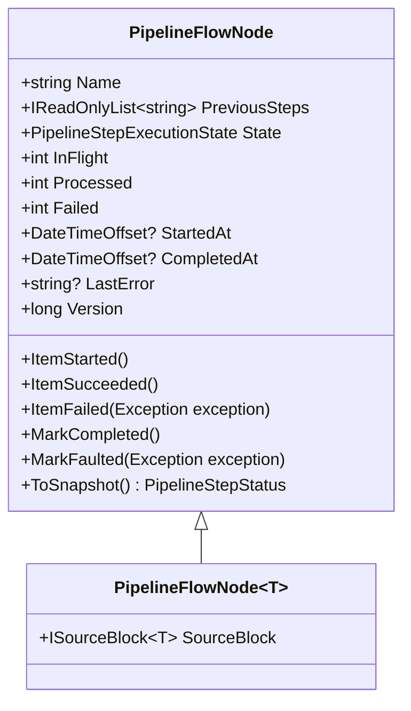
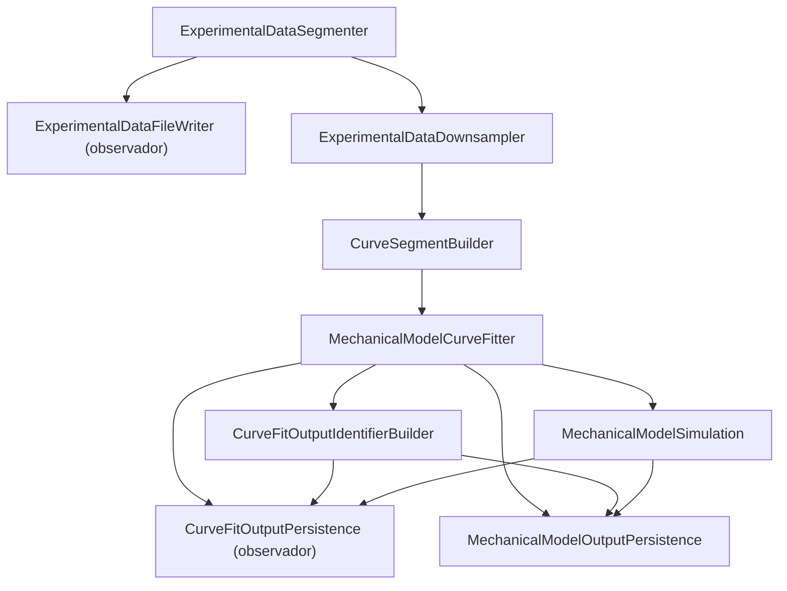

# Planejamento Técnico: Execução Assíncrona (HTTP 202), Monitoramento SSE, Topologia Declarativa e Purga de Legados

> **Documento mestre.** Única fonte de verdade deste planejamento. A cópia em `.agents/prompt/` é apenas um redirecionamento.
>
> **Revisão 4 (2026-10-27).** Mudanças em relação à rev. 3:
> 1. Fase 0 simplificada: remove os endpoints `/stream` já na estabilização, eliminando a regressão do notifier **sem alterar a assinatura de `PipelineFactory`** (D1 revista).
> 2. Localização de cada componente por pacote (§2), respeitando o grafo real de referências.
> 3. SSE com mecanismo único de *polling* temporal (sem `WaitForTopologyAsync` nem eventos de mudança de estado) e `heartbeat` como evento (comentários SSE não são garantidos por `SseItem<T>`).
> 4. Regras explícitas para: falhas de item contadas antes do tratamento de erro, cancelamento de job ainda na fila, distinção `Cancelled` × `Interrupted`, execuções que terminam sem topologia, corrida de descarte do `CancellationTokenSource`, conflito de unicidade no banco.
> 5. D4 antecipada para antes da Fase 1 (os testes da Fase 1 dependem dela).

---

## 0. Estado Atual e Premissas

### 0.1 Estado do repositório no início deste plano
| Item | Situação | Tratamento |
|---|---|---|
| Build da solução | **Quebrado** — 10 erros em `MelloSilveiraTools.MechanicsOfMaterials.Optimizations` | Fase 0 |
| `ChannelPipelineProgressNotifier` registrado como **Singleton** (alteração da sessão anterior) | **Regressão**: canal único compartilhado entre requisições (`SingleReader = true`) e encerrado para sempre pelo primeiro `TryComplete()` em `PipelineProgressStreamWriter` | Fase 0 (D1) |
| `CHANGELOG.md` e `CoreDependencyInjectionTests` | Documentam/validam a regressão como comportamento correto | Fase 0 |
| `StorageEntryMetadataEntity` | `required` removido de `StorageProvider`, `Location`, `Directory` para satisfazer `new()` de `CrudController` — decisão não aprovada | D2 |
| Avisos de build | ~6.250, majoritariamente no código-fonte ALGLIB embarcado | Fase 0 |
| `AGENTS.md` | Exige `IPipelineProgressNotifier` obrigatório e descreve `Optimizations → MechanicsOfMaterials` apenas; na prática `Optimizations` também referencia `Database` e `WebApi` | D3 |
| Schema do banco | Não há DDL em `src/`; tabelas são provisionadas fora do código | §7.8 |

### 0.2 Premissas e limitações explícitas
1. **Instância única da API.** Fila e monitores vivem na memória do processo. Múltiplas réplicas **não são suportadas** nesta versão.
2. **Sem reexecução automática após queda.** Execuções interrompidas são marcadas `Interrupted` (§7.6); reexecução é por nova submissão.
3. **Sem progresso em tempo real entre a Fase 0 e a Fase 4.** O streaming atual (`/stream`) já está quebrado; ele é removido na Fase 0 e substituído pelo SSE na Fase 4.
4. **Toda fase termina com build verde e testes passando.**

---

## 1. Arquitetura de Execução

### 1.1 Fluxo Operacional



> Quem grava o estado no banco é o **worker** (ou o command, na admissão). Pipelines de domínio não conhecem `pipeline_runs`.

### 1.2 Regras de Ouro
1. **Zero retrocompatibilidade:** legados são excluídos, não marcados como obsoletos.
2. **SRP:**
   - `PipelineFactory` — Singleton stateless. Após a Fase 2: construtor `(TimeProvider timeProvider)`; `CreateDataflow<T>(ILogger logger, PipelineMonitor monitor, ...)`. Nunca armazena o monitor em campo.
   - `PipelineStepExecutor` — execução, OpenTelemetry, log, retry e atualização atômica do nó. Não conhece HTTP.
   - `PipelineFlowNode` — bloco TPL + predecessores + contadores.
   - `PipelineMonitor` — topologia, nós e estado global de **uma** execução. Não emite eventos; é apenas lido.
   - `PipelineMonitorRegistry` — monitores ativos, solicitações de cancelamento e retenção.
   - `IPipelineRunStore` — ciclo de vida durável. Usado só pelo command (admissão) e pelo worker.
   - `PipelineRunBackgroundService` — consumo da fila, escopos, concorrência, cancelamento, reconciliação.
   - `PipelineMonitoringSettings` — configuração do host. Nunca atravessa builders ou steps.
3. **Dois níveis de estado:** RAM para telemetria fina (efêmera); PostgreSQL para ciclo de vida (auditoria — não recupera execuções).
4. **Desconectar o SSE nunca cancela a execução.**

---

## 2. Localização por Pacote

Respeita as referências reais: `Database → Core`, `WebApi → Core, Database`, `Optimizations → MechanicsOfMaterials, Database, WebApi`.

| Pacote | Componentes |
|---|---|
| **Core** (`MelloSilveiraTools.Core.Pipelines.Monitoring`) | Enums e records (§4.1), `PipelineFlowNode`, `PipelineFlowNode<T>`, `PipelineMonitor`, `PipelineMonitorRegistry`, `PipelineRunQueue`, `PipelineRunJob` (base abstrata), `IPipelineRunHandler`, `IPipelineRunStore`, `PipelineMonitoringSettings`; `StatusCode.Accepted` e `Result.CreateAccepted<T>` (`Core.Models`); `StorageContexts` (`Core.Managers.File`) |
| **Database** | `PipelineRunEntity`, `PostgresPipelineRunStore : IPipelineRunStore` |
| **WebApi** | `PipelineRunBackgroundService`, endpoints genéricos `PipelineRunsEndpoints` (status, eventos SSE, cancelamento), `AddPipelineMonitoring(settings)` em `WebApiDependencyInjection` |
| **Optimizations** | `ExperimentalDataRunJob`, `ParametricSweepRunJob`, `ExperimentalDataRunHandler`, `ParametricSweepRunHandler`, commands de admissão |
| **Meta** | `AddToolsServices` repassa `PipelineMonitoringSettings` |

---

## 3. Inventário de Remoção de Legados

| Arquivo / elemento | Fase | Motivo |
|---|---|---|
| `Optimizations/Controllers/PipelineProgressStreamWriter.cs` | **0** | Consumidor do notifier; quebrado pela regressão |
| Endpoints `POST .../experimental-data/process/stream` e `POST .../parametric-sweeps/stream` | **0** | Idem |
| Registro de `ChannelPipelineProgressNotifier` em DI | **0** | Causa da regressão |
| `Core/Pipelines/Notifiers/IPipelineProgressNotifier.cs`, `ChannelPipelineProgressNotifier.cs`, `NullPipelineProgressNotifier.cs` | 2 | Substituídos por `PipelineMonitor` |
| `Core/Pipelines/Telemetry/PipelineFlowNode.cs` (versão atual) | 2 | Substituído pelo nó unificado em `Pipelines.Monitoring` |
| `Core/Pipelines/Telemetry/PipelineStepTracker.cs` | 2 | Absorvido pelo nó unificado |
| `Core/Pipelines/Telemetry/PipelineProgressNotificationSettings.cs` | 2 | Throttling deixa de existir |
| `Core/Pipelines/Models/PipelineProgressEvent.cs`, `PipelineStepState.cs` | 2 | Substituídos pelos contratos do §4.1 |
| Parâmetros `enablePipelineProgressNotifications` e `pipelineProgressNotificationSettings` de `AddCoreServices` / `AddToolsServices` | 2 | Idem |
| Testes `PipelineProgressEventTests`, `ChannelPipelineProgressNotifierTests`, `PipelineProgressEmissionTests` | 2 | Cobrem código excluído |

---

## 4. Modelos de Monitoramento

### 4.1 Contratos
```csharp
public enum PipelineStepExecutionState { Pending = 0, Running = 1, Completed = 2, Faulted = 3 }

public enum PipelineRunState
{
    Queued = 0,
    Running = 1,
    Completed = 2,
    CompletedWithErrors = 3,
    Faulted = 4,
    Cancelled = 5,
    Interrupted = 6,
    Rejected = 7
}

public sealed record PipelineTopologyNode(string Name, IReadOnlyList<string> PreviousSteps);

public sealed record PipelineStepStatus(
    string Name,
    PipelineStepExecutionState State,
    int Processed,
    int Failed,
    int InFlight,
    DateTimeOffset? StartedAt,
    DateTimeOffset? CompletedAt,
    string? LastError);

public sealed record PipelineRunSummary(
    string Identifier,
    string PipelineType,
    PipelineRunState State,
    DateTimeOffset CreatedAt,
    DateTimeOffset? StartedAt,
    DateTimeOffset? CompletedAt,
    string? Error);
```

### 4.2 Semântica de estados
**Passo:**
- `Pending` → `Running` no primeiro `ItemStarted`.
- `Completed` quando `block.Completion` conclui com sucesso — inclusive diretamente de `Pending`, se o passo não recebeu itens.
- `Faulted` quando `block.Completion` falha. Falhas isoladas de item não mudam o estado do passo.

**Contagem de falhas:** o `PipelineStepExecutor` chama `ItemFailed` **antes** de delegar ao tratamento configurado (`WithLoggingErrors`, DLQ ou propagação). Assim, falhas engolidas continuam visíveis.

**Execução** (decidida pelo worker, nesta ordem de precedência):
| Condição | Estado |
|---|---|
| Fila cheia na admissão | `Rejected` (gravado pelo command) |
| `stoppingToken` cancelado durante a execução | `Interrupted` |
| Cancelamento explícito (antes ou durante a execução) | `Cancelled` |
| Exceção escapou do handler ou `pipeline.Completion` falhou | `Faulted` |
| Concluiu com algum nó `Failed > 0` | `CompletedWithErrors` |
| Concluiu sem falhas | `Completed` |

**Execuções sem topologia:** `Rejected`, `Cancelled` antes de iniciar, `Interrupted` antes de iniciar e `Faulted` antes de `BuildTerminal()` (ex.: modelo mecânico inválido) terminam sem topologia publicada. O cliente deve tratar `run` terminal sem `topology` prévia.

### 4.3 Concorrência nos nós
- `InFlight`, `Processed`, `Failed`: `Interlocked`.
- `StartedAt`: `long` (ticks UTC) gravado uma única vez via `Interlocked.CompareExchange`.
- `CompletedAt`, `LastError`, `State`: `Volatile.Write` / `Volatile.Read`.
- `Version`: `Interlocked.Increment` **após** cada mutação.
- **Snapshot com consistência eventual:** campos lidos individualmente podem refletir instantes ligeiramente diferentes. O snapshot final de um passo só é considerado estável após `block.Completion`.

---

## 5. Modelo de Nós e Regras de Topologia

### 5.1 Hierarquia


### 5.2 Nós nomeados × conectores transparentes
Só **passos `IPipelineStep`** viram nós visíveis. Os demais elementos são conectores transparentes que apenas propagam predecessores.

| Elemento do builder | Visível? | Predecessores propagados |
|---|---|---|
| Buffer de entrada | Não | `[]` |
| `AddStep(step)` | Sim (`step.Name`) | — |
| `AddBroadcastStep(step, ...)` (observador) | Sim (`step.Name`) | O fluxo principal mantém os predecessores **anteriores** ao observador |
| `AddDataMapping`, `AddFilterStep`, `AddCollectAllStep`, `AddGroupWhileStep` | Não | Repassa os recebidos |
| Ramo de `Fork` sem passos (`branch => branch`) | Não | Predecessores da origem do fork |
| `JoinBlock` do `Fork` | Não | União **deduplicada, em ordem de declaração**, dos predecessores finais de cada ramo |

O builder carrega `IReadOnlyList<string> CurrentPredecessors` em vez de `currentNode.Name`. Cada nó nomeado recebe `PreviousSteps = CurrentPredecessors` e redefine `CurrentPredecessors = [step.Name]`.

### 5.3 Unicidade e congelamento
- Nomes de passos são únicos por execução; `BuildTerminal()` valida e lança `InvalidOperationException` listando duplicatas. Não há nomes reservados.
- `BuildTerminal()` chama `monitor.PublishTopology(...)` **uma única vez**; segunda chamada lança `InvalidOperationException`.
- `PipelineMonitor.Topology` é `null` até a publicação (o SSE apenas verifica a cada tick).

### 5.4 Topologia esperada — `ExperimentalDataProcessingPipeline`
Derivada do código atual: `Fork` de 3 ramos (`originalBranch` vazio) → `JoinBlock` → observador `CurveFitOutputPersistence` → mapeamento → `MechanicalModelOutputPersistence`.



| Nó | `previousSteps` |
|---|---|
| ExperimentalDataSegmenter | `[]` |
| ExperimentalDataFileWriter | `["ExperimentalDataSegmenter"]` |
| ExperimentalDataDownsampler | `["ExperimentalDataSegmenter"]` |
| CurveSegmentBuilder | `["ExperimentalDataDownsampler"]` |
| MechanicalModelCurveFitter | `["CurveSegmentBuilder"]` |
| CurveFitOutputIdentifierBuilder | `["MechanicalModelCurveFitter"]` |
| MechanicalModelSimulation | `["MechanicalModelCurveFitter"]` |
| CurveFitOutputPersistence | `["MechanicalModelCurveFitter", "CurveFitOutputIdentifierBuilder", "MechanicalModelSimulation"]` |
| MechanicalModelOutputPersistence | `["MechanicalModelCurveFitter", "CurveFitOutputIdentifierBuilder", "MechanicalModelSimulation"]` |

### 5.5 Topologia esperada — `ParametricSweepPipeline`
Derivada do código atual: `Fork` externo (ramo de cálculo com mapeamento + `Fork` interno de 3 passos; ramo de variável só com mapeamento) → mapeamento → escritor → `AddCollectAllStep` → finalização → persistência.

| Nó | `previousSteps` |
|---|---|
| SweepIngestion | `[]` |
| InitialStressCalculation | `["SweepIngestion"]` |
| FinalStressCalculation | `["SweepIngestion"]` |
| AsymptoteCalculation | `["SweepIngestion"]` |
| ParametricSweepCsvWriter | `["InitialStressCalculation", "FinalStressCalculation", "AsymptoteCalculation", "SweepIngestion"]` |
| ParametricSweepFinalization | `["ParametricSweepCsvWriter"]` |
| ParametricSweepPersistence | `["ParametricSweepFinalization"]` |

> Nomes esperados; os valores reais vêm de `IPipelineStep.Name` e são fixados por teste de topologia (Fase 5). Se algum `Name` atual divergir, ajustar a tabela — não o teste.

---

## 6. Contrato SSE

### 6.1 Rota e autenticação
- `GET /api/v1/pipeline-runs/{identifier}/events`, mesma política de autorização das demais rotas.
- O `EventSource` nativo não envia `Authorization` (**D5**; recomendado: cliente baseado em `fetch` enviando `Authorization: Bearer`).

### 6.2 Serialização
- `TypedResults.ServerSentEvents(IAsyncEnumerable<SseItem<string>>)` com JSON pré-serializado (eventos heterogêneos).
- `System.Text.Json` com `JsonSerializerDefaults.Web` e `JsonStringEnumConverter`.

### 6.3 Eventos
| Evento | Quando | `id` | Payload |
|---|---|---|---|
| `run` | Na abertura e sempre que `State` mudar | `final` somente no estado terminal | `PipelineRunSummary` |
| `topology` | Uma vez, no primeiro tick em que `monitor.Topology != null` | — | `PipelineTopologyNode[]` |
| `steps` | Completo logo após `topology`; depois, apenas nós com `Version` acima da última vista nesta conexão | — | `PipelineStepStatus[]` |
| `heartbeat` | Quando nada foi emitido durante `KeepAliveInterval` | — | `{}` |

### 6.4 Algoritmo (mecanismo único de *polling*)
1. Se `Last-Event-ID == "final"` → `204 No Content` (encerra o ciclo de reconexão automática).
2. Monitor ausente no registro:
   - linha inexistente em `pipeline_runs` → `404`;
   - linha terminal → `204` (o cliente usa `GET /pipeline-runs/{identifier}`);
   - linha `Queued`/`Running` sem monitor (não deve ocorrer após reconciliação) → `404` com log de aviso.
3. Emitir `run` com o estado atual.
4. Laço com `PeriodicTimer(PublishInterval, timeProvider)` e `Dictionary<string, long> lastSeenVersions` por conexão. A cada tick:
   1. Se o estado mudou → emitir `run`.
   2. Se a topologia ficou disponível e ainda não foi enviada → emitir `topology` e `steps` completo.
   3. Senão, se há nós com versão nova → emitir `steps` incremental.
   4. Se nada foi emitido durante `KeepAliveInterval` → emitir `heartbeat`.
   5. Se o estado é terminal → emitir `steps` incremental pendente (se houver topologia), `run` com `id: final` e encerrar.
5. `HttpContext.RequestAborted` encerra apenas o laço desta conexão.

Uma conexão aberta com a execução já terminal (dentro da retenção) percorre o mesmo laço: no primeiro tick recebe `topology` + `steps` completo (se houver) e o `run` final.

### 6.5 Exemplo
```sse
event: run
data: {"identifier":"exp-9c8e1a","pipelineType":"ExperimentalData","state":"Running","createdAt":"2026-10-27T08:30:00.900Z","startedAt":"2026-10-27T08:30:01.120Z","completedAt":null,"error":null}

event: topology
data: [{"name":"ExperimentalDataSegmenter","previousSteps":[]},{"name":"ExperimentalDataFileWriter","previousSteps":["ExperimentalDataSegmenter"]}]

event: steps
data: [{"name":"ExperimentalDataSegmenter","state":"Completed","processed":15420,"failed":0,"inFlight":0,"startedAt":"2026-10-27T08:30:01.120Z","completedAt":"2026-10-27T08:30:02.450Z","lastError":null}]

event: heartbeat
data: {}

id: final
event: run
data: {"identifier":"exp-9c8e1a","pipelineType":"ExperimentalData","state":"CompletedWithErrors","createdAt":"2026-10-27T08:30:00.900Z","startedAt":"2026-10-27T08:30:01.120Z","completedAt":"2026-10-27T08:30:08.500Z","error":null}
```

---

## 7. Ciclo de Vida do Job

### 7.1 Modelo de job
```csharp
public abstract record PipelineRunJob(string Identifier, string PipelineType);

public sealed record ExperimentalDataRunJob(string Identifier, ExperimentalDataProcessingParameters Parameters)
    : PipelineRunJob(Identifier, PipelineTypes.ExperimentalData);

public sealed record ParametricSweepRunJob(string Identifier, ParametricSweepInput Input)
    : PipelineRunJob(Identifier, PipelineTypes.ParametricSweep);
```
- O job **nunca** carrega `Stream` nem `IFormFile`.
- `ExperimentalDataProcessingInput` deixa de conter `StrainStream`/`StressStream`. O handler abre os streams via `IFileStorageService.OpenReadAsync(identifier, StorageContexts.Uploads, fileName)` dentro do escopo e os descarta ao final com `await using`.

### 7.2 Handlers
`IPipelineRunHandler` (`Task ExecuteAsync(PipelineRunJob job, PipelineMonitor monitor, CancellationToken cancellationToken)`) registrado como serviço **keyed Scoped** por `PipelineType`.

### 7.3 Admissão (command) — ordem e compensação
1. Validar o payload.
2. Resolver o identifier: ausente → `Guid.NewGuid().ToString("N")`; informado → validar `^[a-zA-Z0-9_-]{1,64}$`.
3. `IPipelineRunStore.TryReserveAsync(identifier, pipelineType, parametersJson)` → `INSERT` com `UNIQUE(identifier)`. Violação de unicidade (SQLSTATE `23505`) → `409`. *Verificar se `PostgresRepository.TryInsertAsync` distingue esse caso; se não, `PostgresPipelineRunStore` trata `PostgresException` diretamente.*
4. Persistir uploads com **nomes fixos** (`strain.csv`, `stress.csv`) — nunca o nome enviado pelo cliente.
5. `PipelineMonitorRegistry.Register(identifier)`.
6. `PipelineRunQueue.TryEnqueue(job)`; falha → compensação em ordem inversa e `503` + `Retry-After`.
7. Responder `202` com `Location: statusUrl`.

Falha em qualquer passo de 4 a 6 desfaz os passos já realizados. A remoção de uploads na compensação é um *rollback* técnico de uma admissão que nunca executou — não se confunde com a regra de purga de dados científicos (§7.8). A linha `Rejected` é mantida para auditoria.

### 7.4 Worker
- `MaxConcurrentRuns` consumidores concorrentes sobre o mesmo `ChannelReader`.
- Por job:
  1. Se `registry.IsCancellationRequested(identifier)` → gravar `Cancelled` no monitor e no store; não executar.
  2. Criar escopo e `CancellationTokenSource` vinculado ao `stoppingToken`; anexá-lo ao registro.
  3. Gravar `Running`, executar o handler e decidir o estado terminal (§4.2).
  4. Em `finally`: **desanexar** o `CancellationTokenSource` do registro e só então descartá-lo.
  ```csharp
  await using AsyncServiceScope scope = serviceScopeFactory.CreateAsyncScope();
  using CancellationTokenSource runCancellation = CancellationTokenSource.CreateLinkedTokenSource(stoppingToken);
  registry.AttachCancellation(job.Identifier, runCancellation);
  try
  {
      IPipelineRunHandler handler = scope.ServiceProvider.GetRequiredKeyedService<IPipelineRunHandler>(job.PipelineType);
      await handler.ExecuteAsync(job, monitor, runCancellation.Token).ConfigureAwait(false);
  }
  finally
  {
      registry.DetachCancellation(job.Identifier);
  }
  ```
- `RequestCancellation` acessa o `CancellationTokenSource` sob `System.Threading.Lock` compartilhado com `Attach`/`Detach`, eliminando corrida com o descarte.
- Falha ao gravar no store é logada e não altera o estado já definido no monitor.

### 7.5 Cancelamento e desligamento
- `POST .../cancel`: registra a solicitação no registro; se houver `CancellationTokenSource` anexado, cancela-o.
- Distinção: cancelamento com `stoppingToken.IsCancellationRequested == true` → `Interrupted`; caso contrário → `Cancelled`.
- Jobs ainda na fila no desligamento se perdem com o `Channel`; suas linhas ficam `Queued` e são resolvidas pela reconciliação (§7.6).

### 7.6 Reconciliação na inicialização
No `StartAsync` do worker, antes de consumir a fila: linhas em `Queued` ou `Running` → `Interrupted`, `error = "Host restarted before completion."`.

### 7.7 Retenção em memória
- Monitores terminais são removidos após `RetentionAfterCompletion`.
- Varredura via `timeProvider.CreateTimer(...)` com período `RetentionSweepInterval`; o timer é descartado com o registro.
- Monitores `Queued`/`Running` nunca expiram por tempo.

### 7.8 Persistência — `pipeline_runs`
| Coluna | Tipo | Observação |
|---|---|---|
| `id` | `bigserial` | PK (`EntityBase`) |
| `identifier` | `varchar(64)` | `UNIQUE` |
| `pipeline_type` | `varchar(64)` | |
| `state` | `smallint` | `PipelineRunState` |
| `parameters_json` | `jsonb` | Serialização polimórfica com **precisão completa** (não usar `SignificantFigures7`) |
| `created_at`, `started_at`, `completed_at` | `timestamptz` | Via `TimeProvider` |
| `error_message` | `text` | |

- Entregar **script DDL versionado** junto com a entidade, seguindo a forma atual de provisionamento das tabelas existentes (`stored_files`, etc.).
- Exclusão definitiva de linhas e arquivos de uma execução só por funcionalidade de purga explícita e isolada.

---

## 8. Endpoints REST e Contrato HTTP

### 8.1 Suporte a 202 no `Result`
`StatusCode` atual não possui `Accepted`. Adicionar `StatusCode.Accepted = 202`, `Result.CreateAccepted<T>(T data)` e o mapeamento em `ToHttpResult` / `BuildHttpResponse`. O cabeçalho `Location` é definido pelo endpoint. Para `503`, usar o existente `CreateServiceUnavailable` + cabeçalho `Retry-After` definido pelo endpoint.

### 8.2 Rotas
| Método e rota | Respostas |
|---|---|
| `POST /api/v1/experimental-data/process` | `202 {identifier, statusUrl, eventsUrl, cancelUrl}` · `400` · `409` · `503` + `Retry-After` |
| `POST /api/v1/parametric-sweeps` | Idem |
| `GET /api/v1/pipeline-runs/{identifier}` | `200 PipelineRunSummary` (registro → fallback `pipeline_runs`) · `404` |
| `GET /api/v1/pipeline-runs/{identifier}/events` | §6 |
| `POST /api/v1/pipeline-runs/{identifier}/cancel` | `202` · `409` (já terminal) · `404` |

---

## 9. Storage
- Layout canônico (já implementado): `{BaseDirectory}/{identifier}/{context}/{fileName}`.
- Contextos em constantes `StorageContexts` (`Uploads`, `Processed`, `Simulations`, `SensitivityAnalysis`), substituindo strings soltas.
- Uploads: nomes fixos, `RequestSizeLimit` no endpoint, validação de tipo de conteúdo.

---

## 10. Configuração — `PipelineMonitoringSettings`
| Propriedade | Validação eager |
|---|---|
| `required TimeSpan PublishInterval` | `> 0` |
| `required TimeSpan KeepAliveInterval` | `> PublishInterval` |
| `required TimeSpan RetentionAfterCompletion` | `> 0` |
| `required TimeSpan RetentionSweepInterval` | `> 0` |
| `required int MaxConcurrentRuns` | `≥ 1` |
| `required int QueueCapacity` | `≥ 1` |
| `required TimeSpan RetryAfter` | `> 0` |

Sem valores padrão. Validação no registro em DI (`AddPipelineMonitoring`).

---

## 11. Fases de Implementação

Cada fase termina com **build verde** e **suíte de testes passando**.

### Fase 0 — Estabilização (requer D1 e D2)
- [ ] Remover `PipelineProgressStreamWriter`, os endpoints `/stream` e o registro de `ChannelPipelineProgressNotifier`; registrar apenas `NullPipelineProgressNotifier.Instance` (Singleton) — `PipelineFactory` permanece Singleton com a assinatura atual.
- [ ] Corrigir os erros de compilação restantes:
  - construtor de `MechanicalModelCurveFitOutput` em `MechanicalModelCurveFitterStepBase`;
  - ordem dos argumentos de `StorageEntryMetadataEntity.Create` em `StoredFilePersistenceStep` e `ParametricSweepPersistenceStep`;
  - `ParametricSweepCsvWriterStep` (interface esperada por `AddStep<ParametricSweepFinalPayload>` e `GeneratedFilesMetadata`);
  - erros dos controllers que sobrarem após a remoção dos endpoints `/stream`.
- [ ] Aplicar D2 em `StorageEntryMetadataEntity`.
- [ ] Corrigir a entrada do `CHANGELOG.md` e o teste de DI que validam a regressão.
- [ ] Marcar `CurveFitting/Algorithms/Alglib/**` como `generated_code = true` no `.editorconfig` e confirmar que os avisos nullable desses arquivos desaparecem.
- [ ] Registrar a linha de base de avisos fora do ALGLIB.

### Fase 1 — Núcleo de monitoramento (Core) (requer D4)
- [ ] Contratos do §4.1.
- [ ] `PipelineFlowNode` / `PipelineFlowNode<T>` com a concorrência do §4.3.
- [ ] `PipelineMonitor` (topologia congelada, estado global, snapshots).
- [ ] `PipelineMonitorRegistry` (registro, cancelamento com `Lock`, retenção por `ITimer`).
- [ ] `PipelineRunQueue`, `PipelineRunJob`, `IPipelineRunHandler`, `IPipelineRunStore`.
- [ ] `PipelineMonitoringSettings`.
- [ ] `StatusCode.Accepted`, `Result.CreateAccepted<T>` e mapeamentos HTTP.
- [ ] Testes unitários dos itens acima.

### Fase 2 — Builder, executor e purga (requer D3)
- [ ] `PipelineFactory`: construtor `(TimeProvider timeProvider)`; `CreateDataflow<T>(ILogger logger, PipelineMonitor monitor, ...)`.
- [ ] `DataflowPipelineBuilder`: `CurrentPredecessors`, regras do §5.2, validação de unicidade e publicação da topologia.
- [ ] `PipelineStepExecutor`: remover throttling e trackers; `ItemFailed` antes do tratamento de erro.
- [ ] Excluir os itens da Fase 2 do §3.
- [ ] Atualizar DI do Core e do meta-pacote.
- [ ] Adaptar `DataflowPipelineBuilderTests`, `EnumerablePipelineStepTests`, `FluentPipelineTests` à instância de `PipelineFactory`.
- [ ] Pipelines de domínio passam a receber `PipelineMonitor` (chamadas atuais usam um monitor local até a Fase 3).

### Fase 3 — Execução em background
- [ ] `PipelineRunEntity`, `PostgresPipelineRunStore` e script DDL (Database).
- [ ] `PipelineRunBackgroundService` com concorrência, cancelamento, desligamento e reconciliação (WebApi).
- [ ] Jobs e handlers keyed (Optimizations).
- [ ] `ExperimentalDataProcessingInput` sem streams.
- [ ] `StorageContexts`.

### Fase 4 — WebApi
- [ ] Commands com admissão e compensação (§7.3).
- [ ] `PipelineRunsEndpoints`: status, SSE e cancelamento.
- [ ] `AddPipelineMonitoring` e integração em `AddToolsServices`.

### Fase 5 — Testes e governança
- [ ] Teste de topologia exata das duas pipelines (§5.4, §5.5).
- [ ] Worker: sucesso, `Faulted`, `CompletedWithErrors`, cancelamento na fila, cancelamento em execução, desligamento (`Interrupted`), reconciliação.
- [ ] SSE: conexão em `Queued`, em `Running`, após o término, reconexão com `Last-Event-ID: final`, execução terminal sem topologia, desconexão sem cancelar a execução, `heartbeat`.
- [ ] Admissão: `409`, `503` com compensação completa.
- [ ] `CHANGELOG.md` e `AGENTS.md` atualizados.

---

## 12. Critérios de Aceite
1. `dotnet build MelloSilveiraTools.sln`: **0 erros** e nenhum aviso novo fora de `Alglib/**` em relação à linha de base da Fase 0.
2. `dotnet test test/UnitTests/UnitTests.csproj`: todos os testes passando.
3. Após o build (que regenera os `.xml` de documentação), `git grep` em `src/` por `IPipelineProgressNotifier`, `ChannelPipelineProgressNotifier`, `PipelineStepTracker`, `PipelineProgressNotificationSettings`, `PipelineProgressEvent`: 0 ocorrências.
4. Topologias iguais às tabelas §5.4 e §5.5 (verificado por teste).
5. Nenhum builder, step ou pipeline de domínio referencia `PipelineMonitoringSettings`, `HttpContext` ou `IPipelineRunStore`.
6. Cliente conectado antes, durante ou depois da execução recebe o estado final e não entra em ciclo de reconexão.
7. Nenhuma linha de `pipeline_runs` permanece `Queued`/`Running` após reinicialização do host.

---

## 13. Decisões Pendentes

| ID | Decisão | Opções | Recomendação | Necessária antes de |
|---|---|---|---|---|
| **D1** | Como eliminar a regressão do notifier | **A.** Remover `/stream` e registrar só `NullPipelineProgressNotifier` (sem progresso em tempo real até a Fase 4) · **B.** Tornar `PipelineFactory` Scoped temporariamente · **C.** Mover o notifier do construtor para parâmetro de `CreateDataflow` | **A** — mantém a `PipelineFactory` Singleton como você definiu e remove código que a Fase 2 apagaria de qualquer forma | Fase 0 |
| **D2** | `StorageEntryMetadataEntity` sem `required` | **A.** Manter sem `required`, com valores padrão · **B.** Restaurar `required` e remover `new()` de `CrudController` e comandos CRUD | **B** — preserva a invariância da entidade; impacto maior | Fase 0 |
| **D3** | Alterar `AGENTS.md` (novo modelo de monitoramento; grafo real de pacotes) | Aprovar · Rejeitar | Aprovar | Fase 2 |
| **D4** | Dependência de testes `Microsoft.Extensions.TimeProvider.Testing` | Adicionar · `TimeProvider` fake próprio | Adicionar — sem sobreposição com dependências atuais | Fase 1 |
| **D5** | Autenticação do SSE | **A.** Cliente `fetch` com `Authorization` · **B.** Token de uso único na query | **A** | Fase 4 |

---

## 14. Riscos Residuais
| Risco | Mitigação |
|---|---|
| Múltiplas réplicas da API | Limitação declarada (§0.2) |
| Perda de execução em queda do host | Reconciliação marca `Interrupted`; reexecução manual |
| Saturação de CPU | `MaxConcurrentRuns` × paralelismo interno do Dataflow, ajustável por configuração |
| Proxies que fecham conexões ociosas | `heartbeat` |
| Snapshot parcialmente inconsistente | Documentado (§4.3) |
| Lacuna de progresso entre Fases 0 e 4 | Declarada (§0.2); `GET` de status fica disponível desde a Fase 4 |

## 15. Trabalho Futuro
- `POST /pipeline-runs/{identifier}/retry` a partir de `parameters_json` e uploads.
- Fila distribuída e backplane para múltiplas réplicas.
- Controle de acesso por dono da execução (coluna `owner`).
