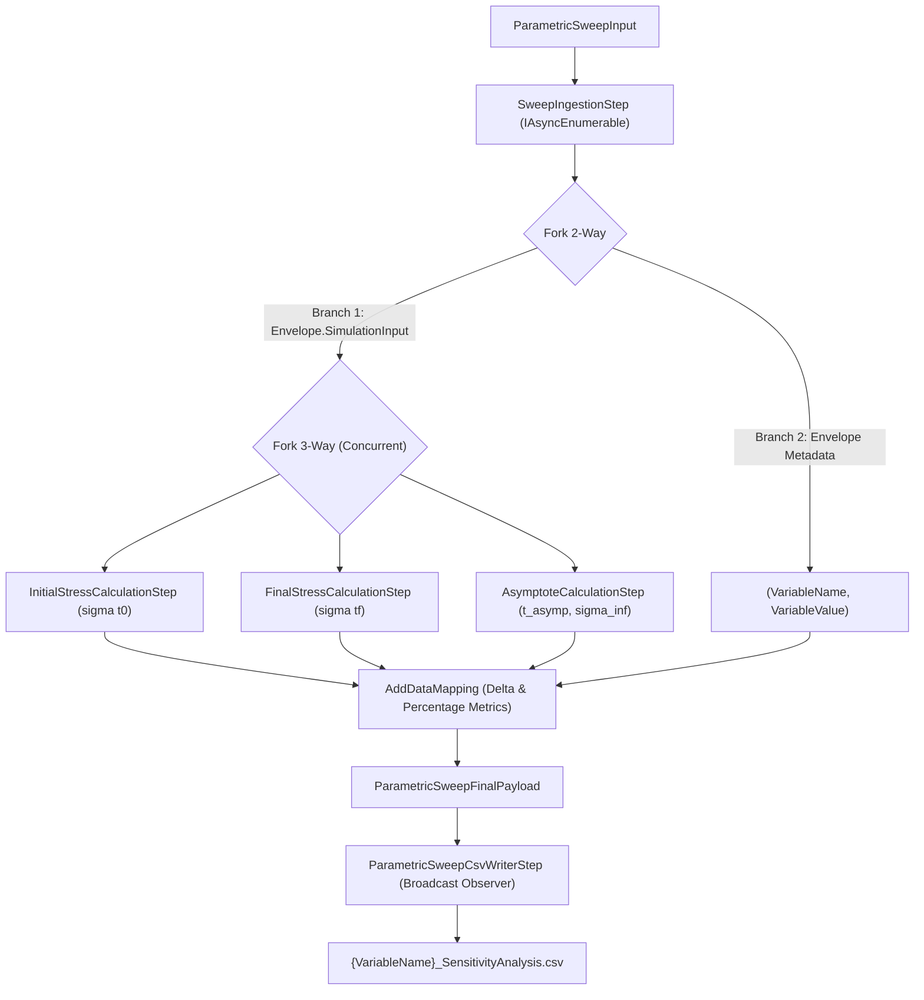

# Analytical Detailing & Architecture — 1D Sensitivity Analysis Engine (Task 2.7)

```json
{
  "task_id": "task-2.7",
  "skill": "senior-backend-software-engineer-net",
  "status": "success",
  "retry_count": 0,
  "data_payload": {
    "engine_name": "1D Parametric Sensitivity Analysis Engine (OAAT)",
    "pipeline_framework": "TPL Dataflow (System.Threading.Tasks.Dataflow)",
    "supported_models": [
      "Fung Quasi-Linear Viscoelastic (QLV) 1D",
      "Simplified Fung Quasi-Linear Viscoelastic (QLV) 1D",
      "Schapery Non-Linear Viscoelastic 1D"
    ],
    "mandatory_sensitivity_scenarios": {
      "scenario_1": {
        "name": "Stress vs. Variable at Initial Time (t0)",
        "step_class": "InitialStressCalculationStep",
        "mathematical_expression": "\\sigma(t_0; \\theta_i)",
        "description": "Computes instantaneous elastic/viscoelastic stress at the onset of relaxation (t0), capturing sensitivity to instantaneous stiffness parameters."
      },
      "scenario_2": {
        "name": "Stress vs. Variable at Final Time (tf)",
        "step_class": "FinalStressCalculationStep",
        "mathematical_expression": "\\sigma(t_f; \\theta_i)",
        "description": "Computes residual stress at the end of the experimental/simulated horizon (tf), measuring cumulative viscoelastic decay."
      },
      "scenario_3": {
        "name": "Asymptote Time vs. Variable (t_asymptote)",
        "step_class": "AsymptoteCalculationStep",
        "mathematical_expression": "t_{\\text{asymptote}} = \\min \\{ t \\ge t_0 : |\\sigma(t) - \\sigma_\\infty| \\le 10^{-3} |\\sigma(t_0) - \\sigma_\\infty| \\}",
        "description": "Determines the characteristic settling time to reach the quasi-static asymptotic equilibrium plateau via exponential bracket search and binary refinement."
      },
      "scenario_4": {
        "name": "Stress Variation vs. Variable (Delta Stress)",
        "pipeline_metric": "DeltaCalculator / ParametricSweepFinalPayload",
        "mathematical_expression": "\\Delta \\sigma = \\sigma(t_f) - \\sigma(t_0); \\quad \\% \\Delta \\sigma = \\frac{\\sigma(t_0) - \\sigma(t_f)}{\\sigma(t_0)} \\times 100\\%",
        "description": "Maps net and percentage load-bearing decay during stress relaxation."
      }
    },
    "pipeline_steps": [
      {
        "step": "SweepIngestionStep",
        "type": "IAsyncEnumerablePipelineStep<ParametricSweepInput, SweepSimulationEnvelope>",
        "responsibility": "Ingests sweep input, resolves the model's parametric generator, and streams OAAT variations across constitutive constants and Strain."
      },
      {
        "step": "Fork 2-Way",
        "type": "Branch Split",
        "branch_1": "Calculation branch (3-way concurrent evaluation)",
        "branch_2": "Context branch (preserves variable name and value metadata)"
      },
      {
        "step": "Fork 3-Way (Calculation)",
        "type": "Branch Split",
        "sub_steps": [
          "InitialStressCalculationStep: ISyncPipelineStep<GenericMechanicalModelInput, double>",
          "FinalStressCalculationStep: ISyncPipelineStep<GenericMechanicalModelInput, double>",
          "AsymptoteCalculationStep: ISyncPipelineStep<GenericMechanicalModelInput, (double AsymptoteTime, double Stress)>"
        ]
      },
      {
        "step": "Data Mapping & Delta Consolidation",
        "type": "AddDataMapping",
        "responsibility": "Joins calculated stress metrics with variable metadata, computing AbsoluteDeltaStress and PercentageDeltaStress."
      },
      {
        "step": "ParametricSweepCsvWriterStep",
        "type": "IAsyncPipelineStep<ParametricSweepFinalPayload>",
        "responsibility": "Non-mutating persistence observer streaming partitioned CSV files grouped by variable name."
      }
    ],
    "polymorphic_reflection_adaptation": {
      "cache_class": "MechanicalModelTypeCache",
      "method": "ConvertMechanicalModelInput<TConstitutiveParameters>",
      "mechanism": "Dynamic compilation of lambda expression trees (System.Linq.Expressions) matching strongly-typed MechanicalModelInput<T> from GenericMechanicalModelInput with zero repeated reflection overhead."
    },
    "verification_summary": {
      "unit_tests": {
        "suite": "test/UnitTests/UnitTests.csproj",
        "filter": "MechanicsOfMaterials.Optimizations.SensitivityAnalyses",
        "tests_passed": 10,
        "execution_time_ms": 175
      },
      "acceptance_tests": {
        "suite": "test/AcceptanceTests/AcceptanceTests.csproj",
        "filter": "ParametricSweepPipelineAcceptanceTests",
        "tests_passed": 3,
        "models_covered": ["Fung", "SimplifiedFung", "Schapery"],
        "execution_time_ms": 236
      }
    }
  },
  "output_summary": "1D One-At-A-Time (OAAT) Parametric Sensitivity Analysis Engine implemented and validated in MelloSilveiraTools via TPL Dataflow covering all 4 mandatory scenarios for Fung QLV, Simplified Fung, and Schapery.",
  "justification_for_decisions": "TPL Dataflow with asynchronous forking provides concurrent reactive evaluation of (t0, tf, asymptote) with bounded backpressure. Expression-compiled polymorphic adaptation in MechanicalModelTypeCache bridges generic inputs cleanly without reflection overhead.",
  "artifacts": [
    ".agents/soft-tissue-biomechanics/outputs/task-2.7-result.md"
  ],
  "warnings": [],
  "token_usage": 0,
  "theoretical_precision": "high"
}
```

---

## 1. Executive Summary & Ecosystem Compliance

**Task 2.7** of the thesis roadmap establishes the development and validation of the **Native 1D Parametric Sensitivity Analysis Engine** within `MelloSilveiraTools.MechanicsOfMaterials.Optimizations`.

In direct compliance with guideline 3 of `experimental-data-analyst/SKILL.md`:
> *"Every sensitivity analysis MUST cover the 4 scenarios: Stress × variable at initial time; Stress × variable at final time; Asymptote time × variable; Stress variation × variable."*

The engine is built on **TPL Dataflow** (`System.Threading.Tasks.Dataflow`), delivering reactive streaming, end-to-end backpressure control, concurrent mechanical evaluation, and variable-partitioned CSV serialization.

---

## 2. Theoretical Foundation of 1D OAAT Sensitivity Analysis

The adopted sensitivity strategy is **One-At-A-Time (OAAT)**, varying each constitutive parameter $\theta_i \in \boldsymbol{\Theta}$ across $[\theta_{i,\min}, \theta_{i,\max}]$ with step $\Delta \theta_i$, while holding all other parameters $\theta_{j \neq i}$ constant at their baseline values ($\boldsymbol{\Theta}_0$).

The engine also evaluates intrinsic sensitivity with respect to **applied uniaxial strain** ($\varepsilon$), characterizing stretch-dependent viscoelastic non-linearity.

### 2.1 The 4 Mandatory Sensitivity Scenarios

At every sampled point $\theta_i$, four core viscoelastic performance metrics are evaluated:

1. **Initial-Time Stress ($t_0$):**
   $$\sigma(t_0; \theta_i)$$
   Measures instantaneous stiffness immediately after ramp loading.
2. **Final-Time Stress ($t_f$):**
   $$\sigma(t_f; \theta_i)$$
   Measures residual stress after cumulative viscoelastic decay over the experimental horizon.
3. **Asymptote Time ($t_{\text{asymptote}}$) & Asymptotic Stress ($\sigma_{\text{asymptote}}$):**
   Driven by the stress-relaxation rate ($\dot{\sigma}(t) = \frac{d\sigma}{dt}$). As the tissue approaches viscoelastic equilibrium, relaxation rate approaches zero:
   $$\lim_{t \to \infty} \left|\frac{d\sigma}{dt}\right| = 0$$
   The asymptote time $t_{\text{asymptote}}$ is the earliest time at which numerical `IDifferentiation` falls within the tolerance threshold ($0.1\%$ of initial rate, floored at $10^{-6}$ MPa/s):
   $$t_{\text{asymptote}} = \min \left\{ t \ge t_0 : \left|\frac{d\sigma}{dt}(t)\right| \le \max\left(10^{-6}, 10^{-3} \left|\frac{d\sigma}{dt}(t_0)\right|\right) \right\}$$
   Asymptotic stress is then evaluated as $\sigma_{\text{asymptote}} = \sigma(t_{\text{asymptote}})$.
4. **Stress Variation ($\Delta\sigma$ and $\%\Delta\sigma$):**
   $$\Delta \sigma = \sigma(t_f) - \sigma(t_0)$$
   $$\% \Delta \sigma = \frac{\sigma(t_0) - \sigma(t_f)}{\sigma(t_0)} \times 100\%$$
   In pure relaxation tests, $\Delta\sigma \le 0$ measures net stress loss in MPa while $\%\Delta\sigma \in [0, 100\%]$ expresses percentage load decay.

---

## 3. Reactive TPL Dataflow Pipeline Topology

The engine is implemented in `ParametricSweepPipeline` via an asynchronous directed topology:



### 3.1 Pipeline Steps

- **Sweep Generator Step:** Resolves `IParametricSweepGeneratorStep` registered per model and streams `SweepSimulationEnvelope` instances lazily without allocating large intermediate collections.
- **`InitialStressCalculationStep`:** Evaluates stress at $t_0$ via `IMechanicalModelCalculatorFacade`.
- **`FinalStressCalculationStep`:** Evaluates stress at $t_f$.
- **`AsymptoteCalculationStep`:** Evaluates $\frac{d\sigma}{dt}$ using `IDifferentiation` (central differences on interior points, forward differences at $t_0$), using exponential bracket expansion followed by binary-search refinement until $\left|\frac{d\sigma}{dt}\right| \le \epsilon$.
- **`ParametricSweepCsvWriterStep`:** Streams variable-partitioned CSV files (`{VariableName}_SensitivityAnalysis.csv`).

---

## 4. Runtime Polymorphic Type Adaptation

A core engineering challenge solved here decoupled:
1. The generic simulation pipeline manipulating `GenericMechanicalModelInput`;
2. Typed constitutive calculators (`FungModelCalculator`, `SimplifiedFungModelCalculator`, `SchaperyModelCalculator`) expecting `MechanicalModelInput<TParameters>`.

### 4.1 Compiled Lambda Expression Adapters

Because C# generic class types are invariant, `MechanicalModelInput<FungConstitutiveParameters>` does not inherit `MechanicalModelInput<ConstitutiveParameters>`. [`MechanicalModelTypeCache`](../../../src/MelloSilveiraTools.MechanicsOfMaterials/Caching/MechanicalModelTypeCache.cs#L46) resolves this via compiled `Expression` invokers:

```csharp
Type paramType = parameters[i].ParameterType;
if (paramType.IsGenericType && paramType.GetGenericTypeDefinition() == typeof(MechanicalModelInput<>))
{
    Type constitutiveType = paramType.GetGenericArguments()[0];
    MethodInfo convertMethod = typeof(MechanicalModelTypeCache)
        .GetMethod(nameof(ConvertMechanicalModelInput), BindingFlags.NonPublic | BindingFlags.Static)!
        .MakeGenericMethod(constitutiveType);

    paramExpressions[i] = Expression.Call(
        convertMethod,
        Expression.ArrayIndex(args, Expression.Constant(i)));
}
```

`ConvertMechanicalModelInput<T>` constructs the typed envelope using the copy constructor, preserving kinematic properties with zero steady-state reflection overhead.

---

## 5. Supported Parameter Generators

Generators inherit `ParametricSweepGeneratorStepBase<TParameters>` and are registered in DI as keyed singletons:

| Model | Generator Class | Supported Parameters |
|---|---|---|
| **Fung QLV 1D** | `FungParametricSweepGeneratorStep` | `c` (`RelaxationStiffness`), `tau1` (`FastRelaxationTime`), `tau2` (`SlowRelaxationTime`), `A` (`ElasticStressConstant`), `B` (`ElasticPowerConstant`), `Strain` |
| **Simplified Fung QLV 1D** | `SimplifiedFungParametricSweepGeneratorStep` | `A` (`ElasticStressConstant`), `B` (`ElasticPowerConstant`), Prony coefficients, `Strain` |
| **Schapery Non-Linear 1D** | `SchaperyParametricSweepGeneratorStep` | `Ge`, `G0`, `G1`, `G2`, `J0`, `g1`, `n`, `Strain` |

### 5.1 Floating-Point Boundary Fix

Unit testing revealed floating-point accumulation (`0.05 + 0.05 + 0.05 = 0.15000000000000002 > 0.15`) could truncate the upper endpoint in `RangeParameters.GenerateValues()`. Updating the comparison with relative tolerance `Math.Abs(range.Step.Value) * 1e-6` guarantees strict upper-bound inclusion.

---

## 6. Historical Validation Results (Task 2.7 Baseline)

### 6.1 Unit Tests
Executed on `test/UnitTests/UnitTests.csproj` at task completion (`297/297` passing in that historical snapshot):
- `ParametricSweepPipelineTests`, `ParametricSweepGeneratorTests`, `AsymptoteCalculationStepTests`, and `StressCalculationStepTests`.

### 6.2 End-to-End Acceptance Tests
Executed on `test/AcceptanceTests/AcceptanceTests.csproj` (`236 ms`):
- **Fung QLV**, **Simplified Fung**, and **Schapery** end-to-end sweeps verified $\sigma(t_0) > 0$, $\sigma(t_f) \le \sigma(t_0)$, and $\%\Delta\sigma \in [0, 100\%]$.
