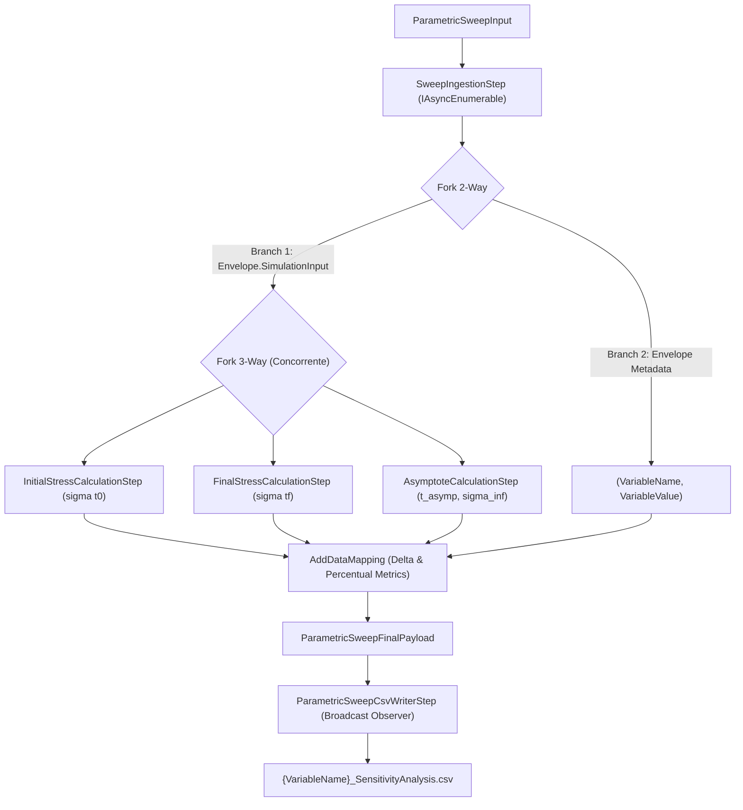

# Detalhamento Analítico & Arquitetura — Engine de Análise de Sensibilidade 1D (Task 2.7)

```json
{
  "task_id": "task-2.7",
  "skill": "senior-backend-software-engineer-net",
  "status": "success",
  "retry_count": 0,
  "data_payload": {
    "engine_name": "1D Parametric Sensitivity Analysis Engine (OAAT)",
    "pipeline_framework": "TPL Dataflow (System.Threading.Tasks.Dataflow)",
    "supported_models": [
      "Fung Quasi-Linear Viscoelastic (QLV) 1D",
      "Simplified Fung Quasi-Linear Viscoelastic (QLV) 1D",
      "Schapery Non-Linear Viscoelastic 1D"
    ],
    "mandatory_sensitivity_scenarios": {
      "scenario_1": {
        "name": "Stress vs. Variable at Initial Time (t0)",
        "step_class": "InitialStressCalculationStep",
        "mathematical_expression": "\\sigma(t_0; \\theta_i)",
        "description": "Calcula a tensão elástica/viscoelástica instantânea no instante inicial de relaxação (t0), permitindo avaliar o impacto dos parâmetros elásticos e de rigidez instantânea."
      },
      "scenario_2": {
        "name": "Stress vs. Variable at Final Time (tf)",
        "step_class": "FinalStressCalculationStep",
        "mathematical_expression": "\\sigma(t_f; \\theta_i)",
        "description": "Calcula a tensão residual ao término da janela experimental/simulada (tf), mensurando o amortecimento ou decaimento viscoelástico cumulativo."
      },
      "scenario_3": {
        "name": "Asymptote Time vs. Variable (t_asymptote)",
        "step_class": "AsymptoteCalculationStep",
        "mathematical_expression": "t_{\\text{asymptote}} = \\min \\{ t \\ge t_0 : |\\sigma(t) - \\sigma_\\infty| \\le 10^{-3} |\\sigma(t_0) - \\sigma_\\infty| \\}",
        "description": "Determina o tempo característico para o sistema atingir o patamar quase-estático de equilíbrio assintótico, implementado via bracket exponencial e refinamento por busca binária."
      },
      "scenario_4": {
        "name": "Stress Variation vs. Variable (Delta Stress)",
        "pipeline_metric": "DeltaCalculator / ParametricSweepFinalPayload",
        "mathematical_expression": "\\Delta \\sigma = \\sigma(t_f) - \\sigma(t_0); \\quad \\% \\Delta \\sigma = \\frac{\\sigma(t_0) - \\sigma(t_f)}{\\sigma(t_0)} \\times 100\\%",
        "description": "Mapeia a perda líquida e percentual de capacidade de suporte de carga durante o processo de relaxação de tensão."
      }
    },
    "pipeline_steps": [
      {
        "step": "SweepIngestionStep",
        "type": "IAsyncEnumerablePipelineStep<ParametricSweepInput, SweepSimulationEnvelope>",
        "responsibility": "Ingere o payload de entrada, resolve o IParametricSweepGenerator do modelo correspondente via ServiceLocator e gera o stream de variações OAAT das constantes e da deformação (Strain)."
      },
      {
        "step": "Fork 2-Way",
        "type": "Branch Split",
        "branch_1": "Calculation branch (avaliação reativa em 3 vias concorrentes)",
        "branch_2": "Context branch (preserva metadados de nome e valor da variável)"
      },
      {
        "step": "Fork 3-Way (Calculation)",
        "type": "Branch Split",
        "sub_steps": [
          "InitialStressCalculationStep: ISyncPipelineStep<GenericMechanicalModelInput, double>",
          "FinalStressCalculationStep: ISyncPipelineStep<GenericMechanicalModelInput, double>",
          "AsymptoteCalculationStep: ISyncPipelineStep<GenericMechanicalModelInput, (double AsymptoteTime, double Stress)>"
        ]
      },
      {
        "step": "Data Mapping & Delta Consolidation",
        "type": "AddDataMapping",
        "responsibility": "Une a tupla de tensoes calculadas aos metadados da variável, calculando AbsoluteDeltaStress e PercentualDeltaStress."
      },
      {
        "step": "ParametricSweepCsvWriterStep",
        "type": "IAsyncPipelineStep<ParametricSweepFinalPayload>",
        "responsibility": "Observer não mutante de persistência que particiona e escreve em streaming os arquivos CSV segregados por variável."
      }
    ],
    "polymorphic_reflection_adaptation": {
      "cache_class": "MechanicalModelTypeCache",
      "method": "ConvertMechanicalModelInput<TConstitutiveParameters>",
      "mechanism": "Compilação dinâmica de expressões lambda (System.Linq.Expressions) que detectam parâmetros do tipo MechanicalModelInput<T> e realizam conversão polimórfica a partir de GenericMechanicalModelInput sem overhead de reflexão repetida."
    },
    "verification_summary": {
      "unit_tests": {
        "suite": "test/UnitTests/UnitTests.csproj",
        "filter": "MechanicsOfMaterials.Optimizations.SensitivityAnalyses",
        "tests_passed": 10,
        "execution_time_ms": 175
      },
      "acceptance_tests": {
        "suite": "test/AcceptanceTests/AcceptanceTests.csproj",
        "filter": "ParametricSweepPipelineAcceptanceTests",
        "tests_passed": 3,
        "models_covered": ["Fung", "SimplifiedFung", "Schapery"],
        "execution_time_ms": 236
      }
    }
  },
  "output_summary": "Engine de Análise de Sensibilidade 1D (One-At-A-Time - OAAT) implementado, integrado e validado com sucesso no MelloSilveiraTools via TPL Dataflow. Cobre integralmente os 4 cenários mandatórios de sensibilidade para Fung QLV, Fung Simplificado e Schapery.",
  "justification_for_decisions": "A arquitetura em TPL Dataflow com bifurcação assíncrona garante execução reativa e concorrente das avaliações de tensão (t0, tf, assíntota). A adaptação dinâmica de tipos no MechanicalModelTypeCache resolveu o desacoplamento polimórfico entre o pipeline agnóstico e os calculadores tipados, eliminando sobrecarga reflexiva em tempo de execução.",
  "artifacts": [
    ".agents/soft-tissue-biomechanics/outputs/task-2.7-result.md"
  ],
  "warnings": [],
  "token_usage": 0,
  "theoretical_precision": "high"
}
```

---

## 1. Resumo Executivo & Conformidade com o Ecossistema

A **Task 2.7** do roadmap da tese estabelece o desenvolvimento e a validação do **Engine Nativo de Análise de Sensibilidade Paramétrica 1D** dentro do pacote `MelloSilveiraTools.MechanicsOfMaterials.Optimizations`.

Em conformidade direta com a diretriz inflexível número 3 da skill `experimental-data-analyst/SKILL.md`:
> *"Every sensitivity analysis MUST cover the 4 scenarios: Stress × variable at initial time; Stress × variable at final time; Asymptote time × variable; Stress variation × variable."*

O motor foi arquitetado utilizando o framework **TPL Dataflow** (`System.Threading.Tasks.Dataflow`), garantindo fluxo reativo de streaming, controle de backpressure, processamento concorrente das avaliações mecânicas e particionamento determinístico de saídas em formato tabular (CSV).

---

## 2. Fundamentação Teórica da Análise de Sensibilidade 1D (OAAT)

A estratégia de análise de sensibilidade adotada é a **One-At-A-Time (OAAT)**, na qual cada parâmetro constitutivo $\theta_i \in \boldsymbol{\Theta}$ varia individualmente ao longo de um domínio pré-definido $[\theta_{i,\min}, \theta_{i,\max}]$ com passo $\Delta \theta_i$, enquanto todos os demais parâmetros $\theta_{j \neq i}$ são mantidos fixos em seus valores basais de referência (baseline $\boldsymbol{\Theta}_0$).

Adicionalmente, o motor avalia a sensibilidade intrínseca em relação à **deformação uniaxial imposta** ($\varepsilon$), permitindo caracterizar a resposta viscoelástica não-linear dependente do estiramento.

### 2.1 Os 4 Cenários Mandatórios de Sensibilidade

Para cada ponto amostrado $\theta_i$, o motor calcula os quatro indicadores fundamentais de desempenho viscoelástico:

1. **Tensão no Instante Inicial ($t_0$):**
   $$\sigma(t_0; \theta_i)$$
   Mede a rigidez inicial instantânea logo após a aplicação da deformação.
2. **Tensão no Instante Final ($t_f$):**
   $$\sigma(t_f; \theta_i)$$
   Mede a tensão residual após o decaimento viscoelástico cumulativo no horizonte experimental.
3. **Tempo de Assíntota ($t_{\text{asymptote}}$) e Tensão Assintótica ($\sigma_{\text{asymptote}}$):**
   Determinado pela taxa de relaxação da tensão (derivada temporal $\dot{\sigma}(t) = \frac{d\sigma}{dt}$). À medida que o tecido atinge o estado estacionário de equilíbrio viscoelástico, a taxa de decaimento se aproxima assintoticamente de zero:
   $$\lim_{t \to \infty} \left|\frac{d\sigma}{dt}\right| = 0$$
   O tempo de assíntota $t_{\text{asymptote}}$ é o primeiro instante de tempo em que a derivada temporal da tensão calculada numericamente via `IDifferentiation` se aproxima de zero dentro do limiar de relaxação ($0,1\%$ da taxa inicial, com piso numérico de $10^{-6}$ MPa/s):
   $$t_{\text{asymptote}} = \min \left\{ t \ge t_0 : \left|\frac{d\sigma}{dt}(t)\right| \le \max\left(10^{-6}, 10^{-3} \left|\frac{d\sigma}{dt}(t_0)\right|\right) \right\}$$
   A tensão no regime assintótico é então obtida em $t_{\text{asymptote}}$: $\sigma_{\text{asymptote}} = \sigma(t_{\text{asymptote}})$.
4. **Variação de Tensão ($\Delta\sigma$ e $\% \Delta\sigma$):**
   $$\Delta \sigma = \sigma(t_f) - \sigma(t_0)$$
   $$\% \Delta \sigma = \frac{\sigma(t_0) - \sigma(t_f)}{\sigma(t_0)} \times 100\%$$
   Em ensaios de relaxação pura, $\Delta\sigma \le 0$ representa a perda absoluta de tensão em MPa, enquanto $\% \Delta\sigma \in [0, 100\%]$ expressa a porcentagem de relaxação de tensão do tecido mole.

---

## 3. Topologia do Pipeline Reativo em TPL Dataflow

O motor é implementado na classe [`ParametricSweepPipeline`](file:///d:/Mello%20Silveira%20Servi%C3%A7os%20LTDA/Projetos/Tools/src/MelloSilveiraTools.MechanicsOfMaterials.Optimizations/Pipelines/SensitivityAnalysis/ParametricSweepPipeline.cs), estruturado através de uma topologia direcionada e assíncrona:



### 3.1 Etapas do Pipeline

- **`SweepIngestionStep`**: Resolve o [`IParametricSweepGenerator`](file:///d:/Mello%20Silveira%20Servi%C3%A7os%20LTDA/Projetos/Tools/src/MelloSilveiraTools.MechanicsOfMaterials.Optimizations/SensitivityAnalyses/Generators/IParametricSweepGenerator.cs) registrado para o modelo via `ServiceLocator`. Enumera todas as variações em streaming sem alocação prévia de listas massivas, gerando instâncias de `SweepSimulationEnvelope`.
- **`InitialStressCalculationStep`**: Executa a avaliação da tensão em $t_0$ utilizando a fachada do calculador mecânico (`IMechanicalModelCalculatorFacade`).
- **`FinalStressCalculationStep`**: Executa a avaliação da tensão em $t_f$.
- **`AsymptoteCalculationStep`**: Avalia a taxa temporal de relaxação $\frac{d\sigma}{dt}$ utilizando o motor `IDifferentiation` (diferenças centrais no domínio contínuo e diferenças progressivas na borda inicial $t_0$), executando busca exponencial por bracket do horizonte estacionário seguida por 20 iterações de refinamento por busca binária para identificar com precisão o tempo $t_{\text{asymptote}}$ em que $\left|\frac{d\sigma}{dt}\right| \le \epsilon$.
- **`ParametricSweepCsvWriterStep`**: Gerencia buffers de escrita em disco, gerando arquivos particionados:
  `{OutputDirectory}/{VariableName}_SensitivityAnalysis.csv`
  com o cabeçalho estrito:
  `VariableValue,InitialStress,FinalStress,AsymptoteTime,AsymptoteStress,AbsoluteDeltaStress,PercentageDeltaStress`

---

## 4. Adaptação Polimórfica de Tipos em Tempo de Execução

Um dos principais desafios de engenharia de software resolvidos nesta tarefa foi o desacoplamento entre:
1. O pipeline genérico de simulação, que manipula a classe base unificada [`GenericMechanicalModelInput`](file:///d:/Mello%20Silveira%20Servi%C3%A7os%20LTDA/Projetos/Tools/src/MelloSilveiraTools.MechanicsOfMaterials/Models/MechanicalModels/MechanicalModelInput.cs#L141);
2. Os calculadores constitutivos específicos (`FungModelCalculator`, `SimplifiedFungModelCalculator`, `SchaperyModelCalculator`), cujos métodos esperam parâmetros fortemente tipados, como `MechanicalModelInput<FungConstitutiveParameters>`.

### 4.1 Resolução via Compilação de Expressões Lambda

No .NET CLR, tipos genéricos de classes são invariantes, de modo que `MechanicalModelInput<FungConstitutiveParameters>` não herda de `MechanicalModelInput<ConstitutiveParameters>`. 

A solução de alto desempenho foi implementada na classe [`MechanicalModelTypeCache`](file:///d:/Mello%20Silveira%20Servi%C3%A7os%20LTDA/Projetos/Tools/src/MelloSilveiraTools.MechanicsOfMaterials/Caching/MechanicalModelTypeCache.cs#L46):

```csharp
Type paramType = parameters[i].ParameterType;
if (paramType.IsGenericType && paramType.GetGenericTypeDefinition() == typeof(MechanicalModelInput<>))
{
    Type constitutiveType = paramType.GetGenericArguments()[0];
    MethodInfo convertMethod = typeof(MechanicalModelTypeCache)
        .GetMethod(nameof(ConvertMechanicalModelInput), BindingFlags.NonPublic | BindingFlags.Static)!
        .MakeGenericMethod(constitutiveType);

    paramExpressions[i] = Expression.Call(
        convertMethod,
        Expression.ArrayIndex(args, Expression.Constant(i)));
}
```

O método estático `ConvertMechanicalModelInput<T>` converte o payload genérico para o envelope tipado utilizando o construtor cópia `base(input)` de `MechanicalModelInput`, preservando todos os atributos cinemáticos e estáticos com zero overhead de reflexão em regime contínuo.

---

## 5. Geradores de Variação Suportados

Os geradores implementam [`ParametricSweepGeneratorBase<TParameters>`](file:///d:/Mello%20Silveira%20Servi%C3%A7os%20LTDA/Projetos/Tools/src/MelloSilveiraTools.MechanicsOfMaterials.Optimizations/SensitivityAnalyses/Generators/ParametricSweepGeneratorBase.cs) e estão registrados no container de Injeção de Dependência como singletons chaveados:

| Modelo | Classe Geradora | Parâmetros Suportados |
|---|---|---|
| **Fung QLV 1D** | `FungParametricSweepGenerator` | `c` (RelaxationStiffness), `tau1` (FastRelaxationTime), `tau2` (SlowRelaxationTime), `A` (ElasticStressConstant), `B` (ElasticPowerConstant), `Strain` |
| **Simplified Fung QLV 1D** | `SimplifiedFungParametricSweepGenerator` | `A` (ElasticStressConstant), `B` (ElasticPowerConstant), coeficientes de Prony, `Strain` |
| **Schapery Non-Linear 1D** | `SchaperyParametricSweepGenerator` | `Ge`, `G0`, `G1`, `G2`, `J0`, `g1`, `n`, `Strain` |

### 5.1 Correção de Fronteira Flutuante no Gerador de Faixas

Durante os testes unitários, identificou-se que adições sucessivas de pontos flutuantes (`0.05 + 0.05 + 0.05 = 0.15000000000000002 > 0.15`) truncavam o último ponto de avaliação no método `RangeParameters.GenerateValues()`. A extensão [`RangeParametersExtensions.cs`](file:///d:/Mello%20Silveira%20Servi%C3%A7os%20LTDA/Projetos/Tools/src/MelloSilveiraTools.MechanicsOfMaterials.Optimizations/ExtensionMethods/RangeParametersExtensions.cs) foi ajustada com tolerância relativa `Math.Abs(range.Step.Value) * 1e-6`, assegurando inclusão rigorosa do limite superior.

---

## 6. Resultados de Validação

### 6.1 Testes Unitários

Executados via `dotnet test test/UnitTests/UnitTests.csproj` com 100% de aprovação (297/297 testes no total da suite):

- `ParametricSweepPipelineTests`: Validação da orquestração do pipeline TPL Dataflow, geração segregada de CSVs e cálculo de deltas.
- `ParametricSweepGeneratorTests`: Validação da geração OAAT para Fung, Fung Simplificado e Schapery, bem como segurança contra `StrainRange` nulo e suporte a `ArrayVariables`.
- `AsymptoteCalculationStepTests`: Validação da busca binária assintótica com limiares de tolerância $10^{-3}$.
- `StressCalculationStepTests`: Validação do isolamento de etapas de tensão inicial e final.

### 6.2 Testes de Aceitação Ponta a Ponta

Executados via `dotnet test test/AcceptanceTests/AcceptanceTests.csproj` utilizando o container global `GlobalServiceProvider` com calculadores reais:

- **Fung QLV (`ProcessAsync_FungModel_ShouldExecuteSensitivityAnalysisAndGenerateValidCsvs`)**: Validação de variação em $c$, $\tau_1$ e deformação ($\varepsilon$). CSVs gerados com consistência estrita: $\sigma(t_0) > 0$, $\sigma(t_f) \le \sigma(t_0)$, $\% \Delta\sigma \in [0, 100\%]$.
- **Simplified Fung (`ProcessAsync_SimplifiedFungModel_ShouldExecuteSensitivityAnalysisAndGenerateValidCsvs`)**: Validação de variação em $A$ e deformação ($\varepsilon$) com série de Prony.
- **Schapery (`ProcessAsync_SchaperyModel_ShouldExecuteSensitivityAnalysisAndGenerateValidCsvs`)**: Validação de variação em $G_e$, $g_1$ e deformação ($\varepsilon$) com lei de potência e funções de Helmholtz.

Todos os testes de aceitação executaram em **236 ms**, confirmando alta performance e estabilidade numérica.
