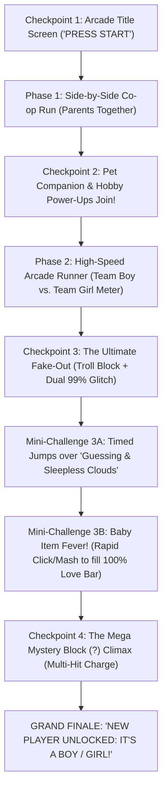

# 🎮 Project Plan: 2D Arcade & Cartoon HD Gender Reveal Web Game

> **Target Directory:** `d:\Mello Silveira Serviços LTDA\Projetos\Tools\gender-reveal-game\`  
> **Codebase Language:** 100% English (identifiers, types, comments, file structure)  
> **UI / On-Screen Language:** Bilingual (`PT-BR` & `EN-US`) with instant toggle and configuration support  
> **Architecture:** Vite + TypeScript + HTML5 Canvas 2D (60 FPS) + Web Audio API Synthesizer + Single-File Bundle Export (`standalone.html`)

---

## 1. Executive Summary & Core Vision

An interactive, high-energy **2D Hybrid Platformer + Party Arcade Runner** web animation designed for a Gender Reveal party (compatible with large TV/projector screens and mobile/WhatsApp sharing).

The experience blends **Arcade Neon / Cyber-Retro 2D** visual spectacle (glowing outlines, energy auras, *Street Fighter / Scott Pilgrim*-style combo callouts, screen shake, hit-stop, chromatic aberration, and laser/firework beams) with **Cartoon HD 2D** character charm (rounded expressive linework, elastic *squash-and-stretch* physics, and vibrant particle bursts).

---

## 2. Gameplay & Narrative Flow (4 Checkpoints + Mini-Challenges)



### Detailed Stage Breakdown

1. **Checkpoint 1 — Title Screen (`TITLE_SCREEN`)**
   - Neon Arcade Title Logo with animated floating clouds, stars, and pulsing energy borders.
   - Displays Player 1 (Mom) and Player 2 (Dad) avatars in idle cartoon bounce animation.
   - Language Toggle (`PT-BR` / `EN-US`), Audio Mute/Unmute toggle, and subtle Gear Icon (`?admin=1` or keyboard shortcut `C`) for the Secret Admin Customizer Modal.
   - Interactive Action: **Click / Tap / Press Space ("PRESS START")** to begin the run.

2. **Phase 1 & Checkpoint 2 — Co-op Run & Pet/Hobby Encounter (`PET_HOBBY_ENCOUNTER`)**
   - Mom and Dad run side-by-side across a lush multi-layered parallax world.
   - Along the path, they collect themed **Hobby Power-Ups** (configurable: gamepad, dumbbell, soccer ball, book, music note, coffee, etc.) that trigger floating cartoon combo callouts (`+100 STYLE!`, `SUPER COMBO!`).
   - **Checkpoint 2 Pause:** Their loyal **Pet Companion** (configurable: Dog, Cat, both, or none, with customizable coat color and name) leaps onto the screen with a dramatic Arcade Entrance banner.
   - Interactive Action: **Click / Tap ("HIGH FIVE! / CONTINUE")** so the Pet joins the squad and boosts running speed!

3. **Phase 2 & Checkpoint 3 — The Double Fake-Out / Troll Block (`FAKE_OUT_SUSPENSE`)**
   - As the squad runs, they collect alternating Blue and Pink energy orbs, driving the top HUD **Team Boy vs. Team Girl** tug-of-war bar to a dead heat.
   - They reach a glowing **Mystery Block (?)** and jump together to strike it:
     - **Part A (Troll Block):** The block bursts with golden/yellow smoke, confetti, and launches a **Giant Neon Rubber Ducky** with a comic banner: `"TROLL BLOCK! NICE TRY!"` (`"BLOCO TROLL! BOA TENTATIVA!"`).
     - **Part B (Dual 99% Glitch Overload):** Suddenly, a massive Blue aura engulfs the screen (`"TEAM BOY CHARGING... 99%"`), then sparks with a cyber-glitch (`"COUNTER-OVERRIDE!"`) and flips into an intense Pink/Magenta aura (`"TEAM GIRL CHARGING... 99%"`).
     - **System Overload:** Sirens flash and a Stork Boss / Arcade Alert declares: `"SYSTEM OVERLOAD: TECHNICAL TIE! COMPLETE THE FINAL CHALLENGES TO UNLOCK PLAYER 3!"`
   - Interactive Action: **Click / Tap ("ACCEPT CHALLENGE! / ACEITAR DESAFIO!")**.

4. **Between Stage 3 & 4 — Interactive Mini-Challenges**
   - **Challenge 3A — Cloud Hurdles (`CHALLENGE_JUMP`):**
     - 3 waves of mischievous *"Palpites / Sleepless Nights"* storm clouds roll toward the running couple and pet.
     - On-screen visual timing ring + **"JUMP! / PULAR!"** button (or Spacebar/Tap). Hitting the jump launches the whole squad in an elastic cartoon arc with neon rainbow trails over the clouds (`"PERFECT JUMP! x3"`).
     - *(Hybrid Safety: If the user is watching hands-free on a TV and doesn't click within the grace window, an "Auto-Assist Shield" bounces them over after a brief suspenseful moment so the party never gets stuck).*
   - **Challenge 3B — Baby Item Shower (`CHALLENGE_SHOWER`):**
     - A Golden fever sky rains down baby bottles, pacifiers, plush bears, rattles, and golden hearts.
     - Rapid Click/Tap anywhere (or mash Spacebar) to magnet-pull items into the couple and supercharge the **"LOVE & HYPE BAR"** from `0%` to `100% MAXIMUM POWER!`.
     - Reaching 100% summons the colossal **Mega Mystery Block (?)** at the center stage.

5. **Checkpoint 4 — Mega Mystery Block Climax (`FINAL_BLOCK_CLIMAX`)**
   - The couple and pet stand beneath the giant, floating, rune-lit **Mega Mystery Block (?)**.
   - Requires **5 interactive hits** (Clicks/Taps/Spacebar):
     - **Hit 1:** Couple jumps and punches the block → Cracks appear, cyan & magenta sparks fly (`"POWER 20%"`).
     - **Hit 2:** Bigger screen shake, lightning arcs, faster drum roll (`"POWER 40%"`).
     - **Hit 3:** Chromatic aberration pulse, shockwave rings, energy beams (`"POWER 60%"`).
     - **Hit 4:** Maximum suspense! Screen zooms in slightly, heartbeat + rising synth pitch (`"CRITICAL CHARGE 99% — ONE MORE HIT!"`).
     - **Hit 5:** **SUPERNOVA DETONATION!** White-out flash + hit-stop freeze frame.

6. **Grand Finale — Maximalist Visual Reveal (`GRAND_REVEAL`)**
   - Explosion of multi-layered particle systems in the revealed theme color (Blue/Cyan/Gold for Boy, or Pink/Magenta/Gold for Girl):
     - Continuous cannon confetti, star bursts, rising neon lasers, and sky fireworks.
   - **Giant Arcade Banner** (no baby name, per specification):
     - **EN:** `"NEW PLAYER UNLOCKED: IT'S A BOY!"` or `"NEW PLAYER UNLOCKED: IT'S A GIRL!"`
     - **PT:** `"NOVO PLAYER DESBLOQUEADO: É MENINO!"` or `"NOVO PLAYER DESBLOQUEADO: É MENINA!"`
   - **Characters Celebration:**
     - A cute cartoon **Player 3 Baby Avatar** (wrapped in a themed glowing cape/blanket with a mini arcade crown/headband) beams down into the parents' arms while the Pet does backflips of joy.
   - **Arcade Victory HUD / Stats Card:**
     - Fun party telemetry: `LOVE LEVEL: 9999%`, `COMBO MAX: ULTRA!`, `SQUAD: MOM + DAD + PET + PLAYER 3`, and buttons for **"Replay Animation"** and **"Launch More Fireworks!"**.

---

## 3. Visual Direction: Arcade Neon + Cartoon HD 2D

To delight the baby's father and dazzle the party audience on any screen, the custom Canvas 2D rendering engine will feature:

| Visual Feature | Implementation Details |
| :--- | :--- |
| **Cartoon HD Characters** | Procedural vector paths with bold dark outlines, cel-shaded highlights, expressive eyes (blinking, wide-eyed during fake-out, star-eyed at reveal), and spring-driven *squash-and-stretch* deformation on every jump and landing. |
| **Neon / Cyber-Retro FX** | Additive blending (`globalCompositeOperation = 'lighter'`), glowing neon borders (`shadowBlur`), speed-lines behind runners, shockwave expansion rings, and floating arcade combat text (`SUPER!`, `CRITICAL!`, `MAX LOVE!`). |
| **5-Layer Parallax World** | 1. Deep twilight/arcade grid sky with twinkling stars; 2. Distant neon mountains & floating castles; 3. Mid-ground pastel clouds & balloons; 4. Foreground lush cartoon hills & party banners; 5. Interactive track & glowing floor tiles. |
| **Camera Juice** | Dynamic trauma-based 2D camera shake, smooth zoom-in during Checkpoint 3 & 4 climax, hit-stop frame pauses on block impacts, and flash overlays. |

---

## 4. Audio Architecture (Hybrid Synthesizer + Custom MP3)

- **Built-in Web Audio API Chiptune/Arcade Synthesizer (`AudioEngine.ts`):**
  - Works 100% offline with **zero external dependencies**.
  - **Procedural BGM Tracks:**
    1. *Title & Running Theme:* Upbeat 16-bit arcade melody (triangle bass + square lead + noise percussion).
    2. *Fake-Out Glitch & Boss Alert:* Dramatic siren arpeggio and tension riser.
    3. *Challenge Fever:* Fast-paced double-time arcade beat.
    4. *Drum Roll & Charge:* Pitch-rising synth + snare roll synchronized with the 5 Mystery Block hits.
    5. *Grand Reveal Fanfare:* Triumphant major-chord brass/chiptune fanfare + firework crackles.
  - **Procedural SFX:** Jump boing, coin/hobby chime, bark/meow pet greeting, rubber ducky squeak (for the Troll Block!), glitch buzz, block punch impact, and firework explosions.
- **Custom MP3 Override Support:**
  - In `gameConfig.ts` (or via Admin Modal), users can optionally provide URLs or local paths (e.g., `/audio/bgm.mp3`, `/audio/victory.mp3`) to play custom songs alongside or instead of the synth BGM.

---

## 5. Configuration, Customization & Bilingual System

### A. Central Configuration (`src/config/gameConfig.ts`)
Strongly typed and thoroughly documented so you can edit defaults in seconds:

```typescript
export interface GameConfig {
  language: 'pt' | 'en';
  revealGender: 'boy' | 'girl';
  autoAssistTimeoutMs: number; // Hybrid mode: auto-advances challenges if no click occurs after N ms
  parents: {
    mom: {
      name: string;
      skinTone: string;
      hairColor: string;
      hairStyle: 'long' | 'bun' | 'curly' | 'short';
      outfitColor: string;
    };
    dad: {
      name: string;
      skinTone: string;
      hairColor: string;
      hairStyle: 'short' | 'fade' | 'curly' | 'bald';
      hasBeard: boolean;
      hasGlasses: boolean;
      outfitColor: string;
    };
  };
  pet: {
    enabled: boolean;
    type: 'dog' | 'cat';
    name: string;
    primaryColor: string;
    secondaryColor: string;
  };
  hobbies: Array<'gamepad' | 'dumbbell' | 'soccer' | 'book' | 'music' | 'coffee' | 'camera' | 'cooking'>;
  themeColors: {
    boyPrimary: string;
    boySecondary: string;
    girlPrimary: string;
    girlSecondary: string;
  };
  customAudio: {
    bgmUrl?: string;
    victoryUrl?: string;
  };
}
```

### B. Secret On-Screen Customizer Modal (`CustomizerModal.ts`)
- Accessible by clicking the subtle **⚙️ Gear Icon** on the top corner, pressing `C` on the keyboard, or opening `?admin=1`.
- Allows live editing of:
  - Language (`Português` / `English`)
  - Revealed Gender (`Menino / Boy` or `Menina / Girl` — hidden behind a "Reveal Spoiler" toggle so you don't accidentally show it while configuring!)
  - Mom & Dad names, skin tones, hairstyles, beard, glasses, and outfit colors
  - Pet toggle, species (`Dog` / `Cat`), name, and fur color
  - Active Hobby icons in the level
- **Persistence & Sharing:**
  - **Save to Browser (`localStorage`)** for instant testing on the party laptop.
  - **Copy Shareable Encoded Link (`?cfg=base64...`)** so you can send a pre-configured link via WhatsApp where the gender is obfuscated in Base64 payload!
  - **Export JSON / TypeScript Config Snippet** to paste directly into `gameConfig.ts`.

---

## 6. Directory Structure & Build Outputs

```text
gender-reveal-game/
├── README.md                        # Complete guide (how to customize, run, build, and share)
├── PLAN.md                          # This architectural & design plan
├── package.json                     # Vite + TypeScript + vite-plugin-singlefile scripts
├── tsconfig.json                    # Strict TypeScript configuration
├── vite.config.ts                   # Standard multi-asset web build config
├── vite.singlefile.config.ts        # Generates standalone single-file HTML bundle
├── index.html                       # Entry HTML with responsive Arcade HUD & canvas container
└── src/
    ├── main.ts                      # Application bootstrapper & event wiring
    ├── style.css                    # Arcade Neon + Cartoon HD UI styles, animations & modal CSS
    ├── config/
    │   ├── gameConfig.ts            # Central easy-to-edit configuration with placeholders
    │   └── i18n.ts                  # Complete PT-BR and EN-US dictionary for all texts/callouts
    ├── audio/
    │   └── AudioEngine.ts           # Web Audio API Chiptune/Arcade synth + custom MP3 player
    ├── entities/
    │   ├── CharacterRenderer.ts     # Cartoon HD Mom, Dad, Pet & Baby procedural renderer (squash & stretch)
    │   ├── ParticleSystem.ts        # Confetti, neon sparks, fireworks, lasers, shockwaves, floating text
    │   └── WorldObjects.ts          # Mystery Blocks, Troll Rubber Ducky, Hobby items, Clouds, Baby items
    ├── engine/
    │   ├── GameEngine.ts            # 60 FPS state machine, hybrid checkpoints, camera shake & physics
    │   └── ParallaxBackground.ts    # 5-layer neon-cartoon parallax environment renderer
    └── ui/
        ├── HudOverlay.ts            # Arcade Top Bar (Boy vs Girl tug-of-war, Love Bar, Stage Prompts)
        └── CustomizerModal.ts       # Secret live configuration modal + encoded URL generator
```

### Build & Delivery Modes
1. **`npm run dev`**: Starts local Vite server with instant Hot Module Replacement (HMR).
2. **`npm run build`**: Generates clean production static folder (`dist/`) ready for GitHub Pages, Vercel, or Netlify.
3. **`npm run build:singlefile`**: Bundles everything into a single self-contained `dist-single/standalone.html` file that opens with a double-click on any party computer or via WhatsApp without needing internet or a web server.

---

## 7. Verification & Acceptance Criteria
- [ ] Zero TypeScript compilation errors (`tsc --noEmit`).
- [ ] Both `npm run build` (standard web bundle) and `npm run build:singlefile` (`standalone.html`) succeed cleanly.
- [ ] All 4 Checkpoints and 2 Mini-Challenges flow smoothly with both manual clicks/keys and hybrid auto-assist fallback.
- [ ] Instant language switching (`PT-BR` ↔ `EN-US`) updates all HUD elements, banners, and stage prompts without restarting.
- [ ] Grand Finale explodes with maximalist visual effects and displays `"NEW PLAYER UNLOCKED: IT'S A BOY!"` / `"IT'S A GIRL!"` (and PT equivalents) without a baby name.
