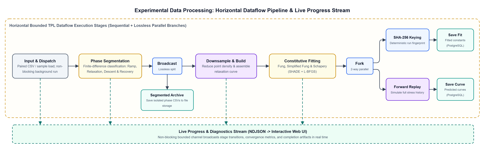
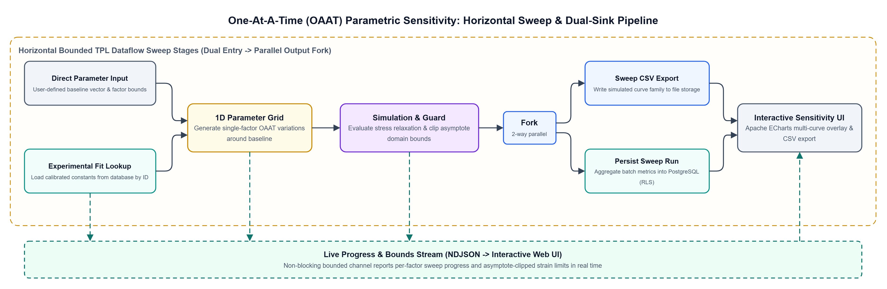

# Summary

`MelloSilveiraTools` is an open-source (GNU GPLv3), modular `.NET 10` / `C# 13` software suite for computational mechanics of materials, viscoelastic constitutive modeling, and automated experimental characterization. Originally created to centralize recurring `.NET` utilities and database integration components across multiple industrial software projects, the framework now focuses primarily on addressing the computational demands of biological soft-tissue mechanics research at Universidade Federal de Ciência e Inovação do Rio de Janeiro (UFCIRJ), while adhering to strict software engineering standards so research and engineering teams in diverse domains can adopt its packages independently.

Organized across eight AOT-compatible NuGet packages (`MelloSilveiraTools.Core`, `Mathematics`, `Database`, `WebApi`, `Plugins`, `MechanicsOfMaterials`, `MechanicsOfMaterials.Optimizations`, and an aggregating meta-package) paired with turnkey CLI, ASP.NET Core, and Blazor WebAssembly hosts (\autoref{fig:architecture}), the framework ingests paired uniaxial `strain.csv` and `stress.csv` recordings, segments cyclic loading regimes, fits constrained linear, quasi-linear, and non-linear viscoelastic laws, and performs parallel One-At-A-Time (OAAT) parametric sensitivity sweeps without proprietary dependencies.


# Statement of need

Characterizing the history-dependent response of polymers and biological soft tissues — notably knee ligaments (ACL, PCL, MCL, and LCL) and tendons — requires evaluating hereditary integrals and calibrating multi-parameter constitutive equations against ramp-and-hold stress-relaxation measurements [@Fung1993; @Provenzano2001; @Duenwald2009; @Bologna2020]. Beyond isolated uniaxial testing [@Rodarte2021; @Rodarte2022], estimating multi-ligament joint load distribution under physiological motion, impact, or ligament injury demands bridging time-dependent relaxation kinetics with static elastic and musculoskeletal baselines [@Silva2022; @Thomeer2020; @Frigo2021; @Beel2024; @Li2024]. Neglecting finite strain-ramp durations $t_0$ biases identified relaxation spectra [@Abramowitch2004], while parameter collinearity demands physically bounded optimization coupled with sensitivity quantification.

In experimental biomechanics, researchers frequently combine ad-hoc scripts with proprietary toolboxes (e.g., MATLAB Optimization Toolbox, OriginLab Pro) or full 3D finite-element solvers [@Maas2012] even when performing scalar uniaxial constitutive identification. Extending foundational non-linear viscoelastic modeling efforts across ligaments [@Schapery1969; @Schapery1997; @Schapery2000; @Provenzano2002; @Blandford2017; @Jamshidi2024] and allied biological tissues such as human dentin [@Emamian2021], while consolidating earlier standalone academic codes [@Silveira2021; @Silveira2022], `MelloSilveiraTools` eliminates licensing barriers and fragmented preprocessing by unifying calculus primitives, uniaxial viscoelastic kernels, global-to-local curve fitting, lossless TPL Dataflow orchestration, and relational tracking inside a single testable `.NET` ecosystem.

# State of the field

General scientific libraries such as `SciPy` [@Virtanen2020] in Python and `FEBio` [@Maas2012] for 3D finite elements provide mature numerical infrastructure, whereas in `.NET`, `MathNet.Numerics` and `ALGLIB` expose general-purpose linear algebra and local optimizers without continuum mechanics abstractions or phase-segmentation pipelines. `MelloSilveiraTools` builds upon `MathNet.Numerics` and embedded `ALGLIB` Free Edition routines to address three domain requirements:

1. **Uniaxial Constitutive Reduction & Finite-Ramp Fidelity:** Constitutive calculators implement a one-dimensional uniaxial scalar reduction of 3D finite-strain continuum mechanics along the loading axis from an unloaded reference state $\varepsilon(0^{-}) = 0$. For Quasi-Linear Viscoelasticity (QLV), Cauchy axial stress $\sigma(t)$ follows the Boltzmann hereditary integral over the exponential elastic response $\sigma^{e}(\varepsilon) = A(e^{B\varepsilon}-1)$ — where $A$ ($\mathrm{MPa}$) is the stress scaling constant and $B$ is the dimensionless stiffening coefficient — with reduced relaxation kernel $G(t)$ normalized at $G(0^{+}) = 1$:

   $$\sigma(t) = \int_{0}^{t} G(t - \tau)\,\frac{\mathrm{d}\sigma^{e}(\varepsilon(\tau))}{\mathrm{d}\tau}\,\mathrm{d}\tau$$

   Direct simulation calculators encompass continuous-spectrum Fung QLV ($G(t)$ via exponential integrals $E_1$) [@Fung1993], discrete Prony-series Simplified Fung QLV [@Abramowitch2004], Schapery's thermodynamic formulation using Helmholtz free-energy strain functions ($h_e, h_1, h_2, G_e$) [@Schapery1969], and the Modified Superposition Method, whereas the automated experimental curve-fitting pipeline natively calibrates the Fung, Simplified Fung, and Schapery relaxation models. Boundary assumptions contrast instantaneous step loading ($\varepsilon(t)=\varepsilon_0 H(t)$, `Disregard`) and full finite-ramp hereditary convolution (`ConsiderWithViscoelasticEffect`), whereas `ConsiderWithoutViscoelasticEffect` evaluates purely elastic loading across the ramp interval ($0 \le t \le t_0$) followed by post-ramp stress relaxation for comparative thesis benchmarking.
2. **Hybrid Constrained Optimization:** Strongly collinear kernels (continuous Fung and multi-branch Prony spectra) are calibrated via derivative-free adaptive Differential Evolution (`GDEMO`/`SHADE`) [@Storn1997] with physical penalty barriers followed by bounded L-BFGS local polishing and Student-$t$ confidence intervals.
3. **Decoupled Scientific Kernels & Turnkey Reproducibility:** Pure domain packages (`Mathematics`, `MechanicsOfMaterials`) remain standalone and free of web or database dependencies for fast local unit testing, while higher layers add backpressure-aware orchestration, deterministic SHA-256 artifact tracking, and interactive visualization.

# Software design

`MelloSilveiraTools.Mathematics` implements lazy-differentiated `Function` hierarchies, `PronySeries` expressions, Simpson quadrature, bounded root finders (`BisectionMethod`, `BrentMethod` [@Brent1971]), and Newmark-$\beta$ integrators [@Newmark1959]. `MelloSilveiraTools.MechanicsOfMaterials` builds on `Mathematics` to provide fatigue criteria (Goodman, Marin), cross-sectional profiles, 3D vector kinematics, and `IMechanicalModelCalculator<T>` implementations accelerated by pre-compiled expression trees in `IMechanicalModelCalculatorFacade`.

At the workflow layer, `MelloSilveiraTools.MechanicsOfMaterials.Optimizations` executes two primary bounded TPL Dataflow pipelines backed by lossless `DataflowFanOut` routing and real-time `IPipelineProgressNotifier` NDJSON streaming:

- **Experimental Identification (`ExperimentalDataProcessingPipeline`, \autoref{fig:experimental_dag}):** `ExperimentalDataProcessingPipeline` triggers background ingestion of CSV pairs through `ExperimentalDataSegmenterStep` (sliding-window finite differences, `BufferSize = 10`, classifying `Ramp`, `Relaxation`, `Descent`, and `Recovery`), forks a copy to `ExperimentalDataFileWriterStep`, downsamples curves, calibrates candidate relaxation models (`Fung`, `SimplifiedFung`, `Schapery`) in `IMechanicalModelCurveFitterStep`, and fans out to deterministic SHA-256 indexing (`CurveFitOutputIdentifierBuilderStep`) and forward simulation (`MechanicalModelSimulationStep`) before PostgreSQL persistence (`PostgresRepository` with Row-Level Security). Multi-specimen folders execute concurrently under `SemaphoreSlim` throttling via `ExecuteBatchExperimentalDataPipeline`.



- **OAAT Parametric Sensitivity (`ParametricSweepPipeline`, \autoref{fig:oaat_sweep}):** Triggered either from custom baseline parameters (`ExecuteParametricSweepPipeline`) or persisted experimental fits queried by `ExternalIdentifier` (`ExecuteParametricSweepFromExperimentalDataCommand`), `IParametricSweepGeneratorStep` constructs one-at-a-time parameter perturbation grids evaluated by `ParametricSweepSimulationStep` with `IRootFinding`-based asymptote domain guarding, exporting CSV families and ECharts-ready series.



Supporting infrastructure packages (`Core`, `Database`, `WebApi`, `Plugins`) follow Domain-Driven Design (DDD), `Repository`, and `Facade` principles to deliver Polly v8 resilience, pure-`Npgsql` persistence, JWE authentication, and collectible `AssemblyLoadContext` plugin hot-loading. Currently, dynamic plugin loading is restricted to custom mechanical constitutive models (`IMechanicalModelCalculator<T>`), allowing external teams to introduce new laws without altering core modules; future releases intend to extend plugin discovery beyond constitutive laws to general numerical methods and solvers. Because foundational kernels remain decoupled from domain workflows, groups in unrelated contexts can also selectively adopt individual NuGet packages. Researchers can evaluate models programmatically or launch the full database, REST/NDJSON API, and Blazor WebAssembly UI (`WebUi`) with a single command:

```bash
# Start turnkey PostgreSQL, WebApi.Host, and Blazor WebUi via Launcher or Docker Compose
dotnet run --project src/MelloSilveiraTools.Launcher/
# Or instantiate domain constitutive models directly in .NET 10
dotnet add package MelloSilveiraTools.MechanicsOfMaterials
```

Automated xUnit unit and Testcontainers-backed acceptance test suites validate analytical identities, numerical convergence, pipeline topology, and collectible plugin isolation.

# Research impact statement

`MelloSilveiraTools` underpins ongoing soft-tissue biomechanics research at PPEMM/UFCIRJ (Rio de Janeiro, Brazil), connecting earlier downstream joint-equilibrium investigations with the present automated characterization platform. Prior to this unified release, earlier NuGet builds of `MelloSilveiraTools.Mathematics`, `MelloSilveiraTools.MechanicsOfMaterials`, `MelloSilveiraTools.Database`, and `MelloSilveiraTools.WebApi` powered a separate API-driven application evaluated in an unpublished complementary manuscript in preparation, analyzing dynamic load redistribution across the four primary porcine knee ligaments (ACL, PCL, MCL, and LCL; $n = 3$ bone-ligament-bone joint sets permuted across 81 combinatorial virtual knee systems sourced from @Rodarte2021 and @Rodarte2022) under Schapery's non-linear viscoelastic theory [@Schapery1969; @Blandford2017] and a 75 N vertical distraction over 1,200 s ($\Delta t = 0.1\text{ s}$, relative residuals $< 0.01\%$).

Compared against the purely static elastic baseline of @Silva2022, the quantitative results reported in that complementary manuscript in preparation demonstrated that neglecting stress relaxation substantially overestimates long-term joint stability. Without initial tension, total vertical resistance dropped by 42.57% to an average of 43.07 N (range: 37.71–50.50 N); conversely, imposing a 3% physiological pre-strain stabilized the joint, limiting decay to 19.36% (mean retained resistance: 60.48 N; range: 51.02–65.13 N), moderating MCL relaxation (44.22% preloaded vs. 49.14% unloaded), and inverting collateral load-sharing dominance in favor of the MCL (rising from 3.99% unloaded to 18.31% preloaded while PCL remained primary stabilizer at 65.70%–69.33%).

Building upon earlier numerical prototyping [@Silveira2021; @Silveira2022], that external API solver is scheduled for decommissioning and full integration into `MelloSilveiraTools`. Concurrently, the unified suite serves as the core computational engine for ongoing Master's thesis research (*Viscoelastic Characterization and Load-Sharing Modeling of Knee Ligaments: A Unified Computational Framework*), automating multi-specimen Fung QLV, Simplified Fung, and Schapery calibration alongside future constitutive extensions under GNU GPLv3.

# AI usage disclosure

Generative AI assistants (Google Antigravity powered by Anthropic Claude and Google Gemini models) were used during software engineering and manuscript preparation for refactoring boilerplate, drafting XML documentation, expanding automated unit test edge cases, generating repository figure scripts, and copy-editing prose against JOSS guidelines. All continuum mechanics derivations, constitutive equations, solver constraints, pipeline designs, and numerical validations were conceived, verified, and audited directly by the authors, who assume full scientific and intellectual responsibility for the software and manuscript.

# Acknowledgements

The authors thank the Graduate Program in Mechanical Engineering and Materials Technology (PPEMM) at Universidade Federal de Ciência e Inovação do Rio de Janeiro (UFCIRJ) for institutional and academic support.

# References
